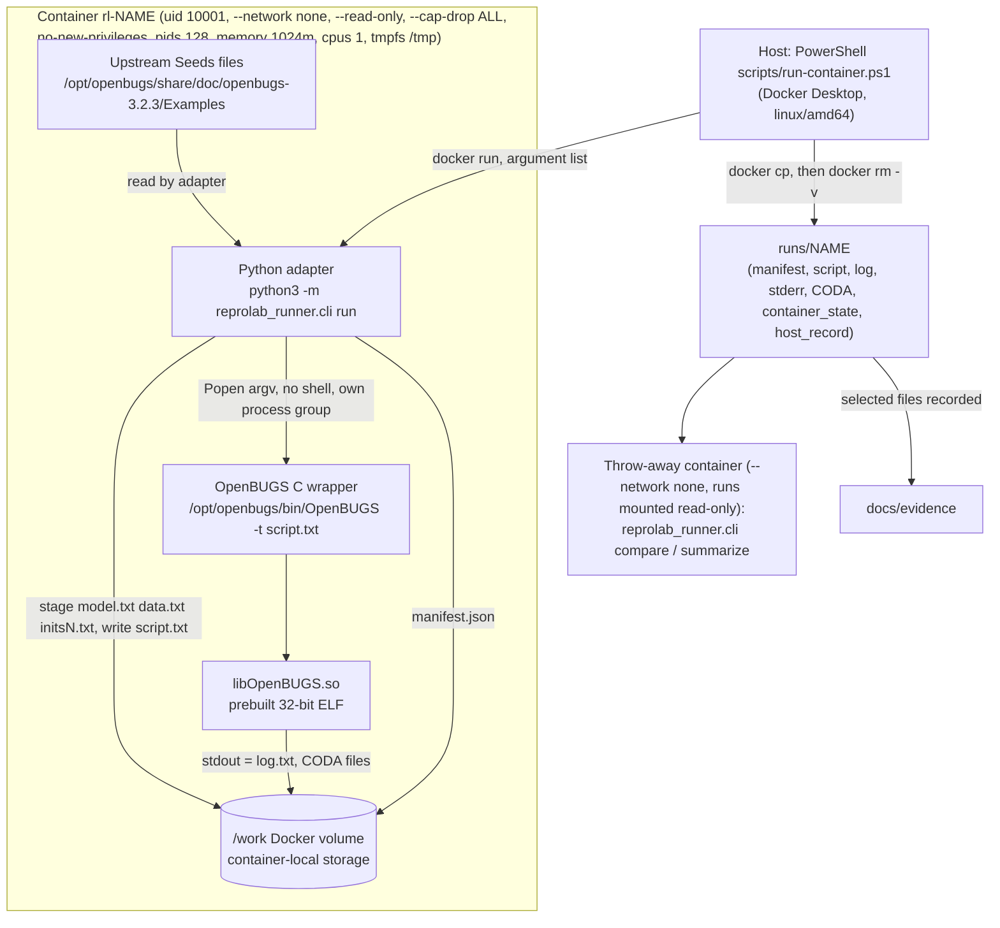
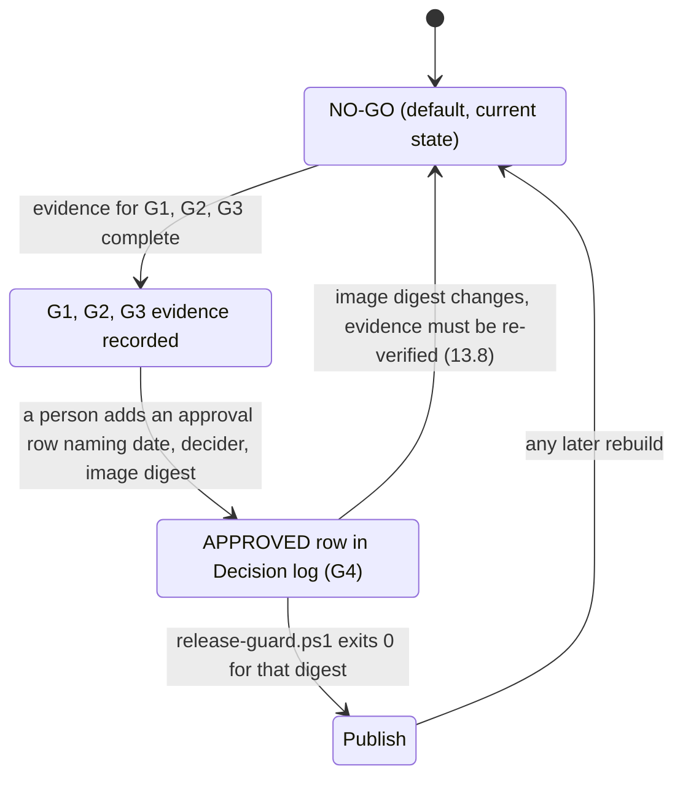

# Design Document

## Overview

This milestone shows that the original OpenBUGS 3.2.3 engine runs the Seeds example on Linux x86-64 and produces real logs and CODA exports. It is a feasibility harness, not a product. It has no Next.js site, no AI assistant and no cloud deployment.

The harness has five parts, all in this repository:

| Part | Path | Role |
|---|---|---|
| Engine image | `infra/openbugs/Dockerfile` | Builds OpenBUGS from a pinned source archive and adds the Python adapter. |
| Adapter | `services/runner/reprolab_runner/adapter.py` | Validates input, generates the Batch_Script, starts the engine, classifies the outcome, writes the Run_Manifest. |
| CODA tools | `reprolab_runner/coda.py`, `reprolab_runner/compare.py`, `reprolab_runner/cli.py` | Parse CODA_Files, compute summaries, apply the Tolerance_Rule, expose `run`, `summarize` and `compare`. |
| Host scripts | `scripts/run-container.ps1`, `scripts/evidence.ps1`, `scripts/feasibility-e2e.ps1` | Start one isolated container per Run, copy results to `runs/<Name>`, always remove the container and volume, summarize manifests and copy the small evidence files to `docs/evidence`. `feasibility-e2e.ps1` rebuilds the image, runs all 7 cases, compares inside the container and asserts the outcomes. |
| Records | `docs/engine-feasibility.md`, `docs/third-party-notices.md`, `docs/licensing-review.md`, `docs/release-inventory.md`, `docs/release-decision.md`, `docs/evidence/` | Provenance, results, limits, licence questions (the licence review is INCOMPLETE), the Release_Gate and its Decision log, and the GO/NO-GO decision. |

The design follows the scientific-integrity rule. OpenBUGS produces every number. ReproLab code only computes labelled summaries from exported samples. A Run is called `succeeded` only when the engine log and the output files show the work was done, because the engine returns exit status 0 even for invalid models.

Decision recorded in `docs/engine-feasibility.md` (Requirements 12 and 13): GO for the engine; NO-GO for Image_Distribution and for the Web_Runner. Image_Distribution stays NO-GO until all four Release_Gate gates (G1 provenance, G2 licence obligations, G3 matching source, G4 recorded decision, defined in `docs/release-decision.md`) are met. The Web_Runner additionally waits for isolation to be tested on the intended worker host. The licence review is INCOMPLETE and no document of this milestone describes it as complete. No gate is met today.

Two licence questions are kept apart throughout this design. (a) The licence for ReproLab_Code is undecided, belongs to the next milestone after legal review, and grants no rights over any Upstream_Component. (b) Permission to redistribute each Upstream_Component is recorded per component in `docs/third-party-notices.md` and `docs/release-inventory.md`, and is unresolved.

## Architecture



Flow of one Run:

1. `run-container.ps1` validates `-Name` against `^[A-Za-z0-9_-]{1,40}$`, refuses to overwrite `runs/<Name>`, reads the image ID with `docker image inspect`, and runs the container with the isolation flags and `-e REPROLAB_IMAGE_DIGEST=<image id>`.
2. Inside the container the adapter reads the model, data and init files, stages them under fixed names in a new work directory under `/work`, writes `script.txt` and starts the engine.
3. The adapter classifies the outcome from the log and output files and writes `manifest.json`.
4. The host script saves `docker inspect` state and copies `/work/<Name>/.` to `runs/<Name>` with `docker cp`. A `finally` block then always removes the container and its volume with `docker rm -f -v`, even if an earlier step failed. The script writes `cli_stdout.txt`, `container_state.json` and `host_record.txt`.
5. `feasibility-e2e.ps1` runs the comparison in a throw-away container from the same image (`--network none`, `runs/` and the reference baseline mounted read-only), so the host needs no Python for comparison.
6. `evidence.ps1` copies the small evidence files from `runs/` into `docs/evidence/` (log, script, manifest, CLI output, host record, container state, comparison output). CODA files and upstream inputs are not copied.

### Design decisions and alternatives

| Decision | Chosen | Alternatives considered | Why |
|---|---|---|---|
| Source of the OpenBUGS archive | Pinned GitHub raw URL (`chjackson/openbugsdoc` at commit `27abd6d1...`) plus SHA-256 check in the Dockerfile | SourceForge download | SourceForge returned an HTML page for every scripted request. The cost is that the checksum is "what the pinned commit serves", not a checksum published by OpenBUGS (Requirement 1.4). This leaves gate G1 unmet. |
| Run status | Derived from log markers, error patterns and output files | Engine exit status | The engine exits 0 for both tested invalid models (Requirement 5.6). Exit status is still checked, but only to fail a Run. |
| Working storage | Docker volume at `/work`, results copied with `docker cp` | Windows bind mount | The engine failed on a bind mount with `Sorry something went wrong in procedure Reader.SetPos in module HostFiles` (Requirement 9.4). |
| Seeds inputs | Read from the image, not committed | Commit copies into `examples/` | The licence for redistributing OpenBUGS examples is unresolved (Requirements 3.8, 11.4, 11.6). Reading them from the image does not make them distributable: the same files are inside the image, which cannot be distributed either (see the Release gate section). Only the SHA-256 of each file is recorded in `docs/evidence/input_hashes_upstream_examples.txt`. |
| Engine start | `Popen([engine, "-t", "script.txt"])` with no shell | `shell=True` with a command string | Removes shell injection. `-t` was the invocation used in all recorded Runs. |
| Comparison statistics | Computed from CODA_Files by ReproLab code | Parse the engine's printed statistics table | Requirement 6.2 asks for statistics from samples. |
| Tolerance | Fixed constants `MEAN_K = 4.0`, `SD_REL = 0.10` | Choose after viewing results | The rule had to exist before the first comparison (Requirement 6.1). |
| Property-based testing | Add Hypothesis later | Hand-rolled generators | Hypothesis is not installed yet. No property-testing code exists today. |

## Components and Interfaces

### Engine image (`infra/openbugs/Dockerfile`)

- `ARG BASE=debian:bookworm-slim@sha256:734a72b3d6142a71993b4bc580ca01d8ca687f77a2c422d96a961d3376b179bc`, used by both stages. Build with `--platform linux/amd64`.
- Build stage: installs `ca-certificates curl build-essential gcc-multilib libc6:i386` (i386 architecture enabled), downloads the archive, runs `echo "$OPENBUGS_SHA256  openbugs.tar.gz" | sha256sum -c -` so a mismatch stops the build, then `./configure --prefix=/opt/openbugs && make && make install`. It copies `COPYING AUTHORS NEWS` to `/opt/openbugs/licenses/`. **This licence set is insufficient for distribution.** It holds only the r1017 `COPYING`, and lacks the GPL v3 text, the upstream r1018 `COPYING`, the BlackBox licence text, component notices and a source pointer (`docs/evidence/licensing/10_*`). The installed `doc/Examples`, `doc/GeoBUGS` and `doc/Reliability` trees carry no licence marker and include third-party data. The image is therefore for local test use only (Requirement 13.1). The planned change is in "Release gate for Image_Distribution".
- Runtime stage: installs `libc6:i386 python3-minimal libpython3.11-stdlib`, creates system user `bugs` with uid 10001, copies `/opt/openbugs` and `services/runner/reprolab_runner` to `/opt/reprolab/`, sets `PYTHONPATH`, creates `/work` owned by 10001, and ends with `USER 10001`.
- Evidence of the build: the final evidence Runs used image ID `sha256:f65e2244463b5899308e9fd51361589de518f9a534fbc62d758e17277e76b88f` (local ID, rebuilt from the Dockerfile after the last code edits). An earlier build, `sha256:787acefe478f0493a04097f1be1bde313251f875bddc2f97de8cd3e9d8edf872`, produced byte-identical CODA files for the same inputs. Both are local IDs, not registry digests. The image has never been pushed, and a local ID must not be turned into a registry digest by pushing before the Release_Gate is met (Requirement 2.9). `OpenBUGS --help` exits 0 (`docs/evidence/e2_image_and_help.txt`).

### Host runner (`scripts/run-container.ps1`)

Parameters: `-Name`, `-RunnerArgs` (runner CLI arguments joined with `|`, split on `|` and passed as separate `docker` arguments), optional `-InputsDir` (mounted read-only at `/inputs`), `-Image` (default `reprolab-openbugs:3.2.3`), `-MemoryMb` (default 1024).

Container flags: `--network none --read-only --cap-drop ALL --security-opt no-new-privileges --pids-limit 128 --memory <n>m --cpus 1 --tmpfs /tmp -v /work`. The user is uid 10001 from the image. `id -u` printed 10001 when run against the full final image ID `sha256:f65e2244...b88f` (`docs/evidence/image_f65e2244_id_u.txt`). `docs/evidence/e2b_uid_and_paths.txt` is from an earlier build and is not evidence for the final image.

The container is removed in a `finally` block with `docker rm -f -v`. `scripts/evidence.ps1` reads `runs/*/manifest.json` and `host_record.txt`, writes `runs/EVIDENCE.txt` with status, exit code, runtime, version, reason and the hashes of the CODA, log and script files, and copies the small evidence files into `docs/evidence/<run>/`.

`scripts/feasibility-e2e.ps1` deletes `runs/`, rebuilds the image, runs seven cases (`seeds-a`, `seeds-b`, `seeds-c`, `seeds-longburn`, `bad-syntax`, `bad-undefined`, `timeout-live`) through `run-container.ps1`, runs five comparisons inside a container, checks for leftover `rl-*` containers, writes `checks.txt`, `comparisons.txt` and `summary.txt`, calls `evidence.ps1`, and exits 0 only if every check matches. Three of the five comparisons are expected to fail; the checks assert the documented outcome, not a match with the baseline.

### Adapter (`reprolab_runner/adapter.py`)

| Name | Signature (summary) | Behavior |
|---|---|---|
| `RunSettings` | frozen dataclass: `monitors: tuple[str,...]`, `burn_in`, `samples`, `thin=1`, `seed: int \| None = None`, `timeout_s=300` | Holds explicit settings (Requirement 3.4). `seed` stays optional in the library API; the CLI makes it required. |
| `RunSettings.validate(n_chains)` | raises `InputError` | Chains 1-4; burn-in 0-50000; samples 1-50000; thin 1-100; seed 1-14 when given; timeout 1-3600; 1-25 unique monitors, each matching `NODE_RE = ^[A-Za-z][A-Za-z0-9_.]{0,63}$`. |
| `read_text_input(path, limit, label)` | returns `bytes` | Size must be 1..limit (model 256 KiB, data and inits 2 MiB). Rejects NUL bytes and non-ASCII. A file that cannot be read (for example a missing file) raises `InputError`. |
| `build_script(settings, n_chains, workdir)` | returns `str` | Validates, then checks `workdir` against `[A-Za-z0-9_./-]+`, then emits the script (below). |
| `classify(exit_code, timed_out, log_text, expected_files)` | returns `(status, reason)` | Log-based decision (below). |
| `run_openbugs(settings, model, data, inits, out_dir, engine=DEFAULT_ENGINE, image_digest=None)` | returns `RunResult` | Stages inputs, writes the script, starts the engine, handles timeout, classifies, writes the manifest including the script text. Raises `InputError` for a missing input file or an output directory that already exists, and `RunnerError` if `manifest.json` cannot be written. |
| `sha256_file(path)` | returns hex digest | Streams 64 KiB chunks. |
| Exceptions | `RunnerError`, `InputError(RunnerError)` | `InputError` means a value, file or output location was rejected before the engine ran. |

#### Generated Batch_Script

`build_script` emits these lines in this order. Items in brackets are conditional.

```
modelSetWD('<workdir>')
modelCheck('model.txt')
modelData('data.txt')
modelCompile(<n_chains>)
[modelSetRN(<seed>)]
modelInits('inits1.txt',1)  ... modelInits('inits<n>.txt',<n>)
modelUpdate(<burn_in>)
samplesSet('<node>')        (one per monitored node)
modelUpdate(<samples>,<thin>)
samplesStats('*')
samplesCoda('*','coda_')
modelQuit('yes')
```

`modelSetRN` is placed before the init files are loaded (Requirement 7.1). The library emits it only when `RunSettings.seed` is set; the CLI always sets it because `--seed` is required. The script never contains `modelDisplay` or `modelSaveLog`, which the Linux engine rejects as unknown commands (Requirement 9.1). The Seeds Runs used `n_chains = 2`, burn-in 1,000 or 20,000, 10,000 samples, thin 1 and monitors `alpha0 alpha1 alpha2 alpha12 sigma`; `docs/evidence/seeds-a/script.txt` is a real example.

#### Process handling

`run_openbugs` calls `subprocess.Popen(argv, cwd=out_dir, stdout=<log.txt>, stderr=<stderr.txt>, stdin=DEVNULL, start_new_session=True)` with `argv = [engine, "-t", "script.txt"]`, then `proc.wait(timeout=settings.timeout_s)`. On `TimeoutExpired` it calls `os.killpg(proc.pid, signal.SIGKILL)` and waits, so the engine's process group is killed and the partial log remains on disk. It then classifies with `timed_out=True`. The engine path is a function parameter that defaults to `DEFAULT_ENGINE`; the CLI does not expose it, so no client chooses the executable.

#### Log-based classification

`classify` evaluates in this order and returns on the first match:

1. `timed_out` is true: `timed_out`.
2. `exit_code != 0`: `failed`, reason "engine exited with status N".
3. Any `ENGINE_ERROR_PATTERNS` regex matches the log: `failed`, reason quotes the first matching line truncated to 200 characters. The patterns, taken from real OpenBUGS 3.2.3 output, are `error pos \d+`, `\bis not defined\b`, `^model must ` (multiline), `unknown script command` and `Sorry something went wrong`.
4. Each string in `REQUIRED_SUCCESS_MARKERS` must appear at or after the position of the previous one: `model is syntactically correct`, `data loaded`, `model compiled`, `model is initialized`, `updates took`, `Node statistics`, `CODA files written`. A missing marker gives `failed`.
5. Any expected file that is missing or empty gives `failed` and its name is listed. Expected files are `coda_CODAchain<k>.txt` for each chain and `coda_CODAindex.txt`.
6. Otherwise `succeeded`.

The `MC_error` column header in a successful log does not match any error pattern (covered by `test_success_log_not_tripped_by_mc_error_header`).

### CODA tools and comparator

| Name | Module | Behavior |
|---|---|---|
| `read_coda(directory, stem="coda_")` | `coda.py` | Reads `<stem>CODAindex.txt` (3 fields per line: node, first row, last row) and each `<stem>CODAchain<k>.txt` (2 fields per line: index, value). Returns `{node: [chain1, chain2, ...]}`. Raises `CodaParseError` for a missing index, no chain files, a wrong field count, a non-numeric value or an index range beyond the rows. |
| `summarize(samples)` | `coda.py` | Pools all chains per node. Returns `n`, `mean` (`math.fsum / n`), `sd` (sample standard deviation, divisor n-1), `q2.5`, `median`, `q97.5` (linear interpolation). Raises `CodaParseError` when a node has fewer than 2 samples. |
| `summarize_per_chain(samples)` | `coda.py` | Same statistics per chain. |
| `select_chains(samples, keep)` | `coda.py` | Keeps the given 1-based chains; raises `CodaParseError` for a chain that does not exist. Used only for labelled post hoc comparisons. |
| `compare(summary, reference, mean_k=4.0, sd_rel=0.10)` | `compare.py` | One row per reference node. |
| `main(argv)` | `cli.py` | Subcommands `run` (`--seed` required, 1-14), `summarize [--per-chain]`, `compare [--chains ...]`. |

**Tolerance_Rule as implemented.** For each reference node: `mean_ok = |mean - ref_mean| <= mean_k * ref_mc_error`, `sd_ok = |sd - ref_sd| <= sd_rel * ref_sd`, and `ok = mean_ok and sd_ok`. A reference node absent from the summary yields `ok = False` with the note "node missing from run". The baseline is `services/runner/reference/seeds_published.json`, transcribed by eye from the results image in the OpenBUGS 3.2.3 Seeds page. The page does not state the number of chains.

**CLI exit codes.** `run`: 0 when `succeeded`, 1 otherwise. `compare`: 0 only when every row has `ok`, 2 otherwise. `RunnerError` (including `InputError`) or `CodaParseError`: `error: <message>` on stderr, exit 3. `compare` prints the rows as JSON.

### Security decisions

- The engine is started from an argument list with no shell. The host script passes `docker` an argument array.
- Staged files get fixed names (`model.txt`, `data.txt`, `inits<k>.txt`), so user file names never reach the script or the file system.
- Every value written into the script is validated first: node names by `NODE_RE`, numeric settings by range, `workdir` by `[A-Za-z0-9_./-]+`.
- Input reads are bounded (256 KiB model, 2 MiB data and inits), ASCII only, no NUL bytes.
- The CLI offers no engine path option, image option or URL option. The container has no network.
- The container runs as uid 10001 (checked on the final image in `docs/evidence/image_f65e2244_id_u.txt`) with a read-only root, all capabilities dropped and no-new-privileges.
- Public custom uploads stay disabled; these Runs were made on Docker Desktop on a developer machine and do not test the production sandbox (Requirement 10).

### Release gate for Image_Distribution

Default state is NO-GO. Image_Distribution (registry push, release asset, download link, `docker save` or exported file given to someone, copy in a hosted image store) needs all four gates met (Requirements 13.1 to 13.6). **No gate is met today.** The real `docs/release-decision.md` still says NO-GO, every gate G1 to G4 is UNMET and there is no APPROVED row. No publishing script or workflow exists. The licence review behind the gates is INCOMPLETE and no legal review has been recorded.



| Gate | Condition (summary) | Status | Evidence file | Evidence now |
|---|---|---|---|---|
| G1 Provenance | Tarball SHA-256 matches a SourceForge browser download or the maintainer; build revision of `libOpenBUGS.so` known | UNMET | `docs/licensing-review.md`, `docs/release-inventory.md` | Checksum not compared (SourceForge returns 403 to scripts); build revision unknown |
| G2 Licence obligations | GPL v2/v3 conflict resolved; image carries the full licence set; CpcBeautifier, TAUCS and Examples terms answered or material excluded; Debian notices kept; legal review recorded | UNMET | `docs/third-party-notices.md`, `docs/release-inventory.md` | Questions open; image ships only r1017 `COPYING`, `AUTHORS`, `NEWS`; no legal review |
| G3 Matching source | Source pointer or offer for `libOpenBUGS.so` names SVN revision and toolchain; Debian source offer or pinned package versions | UNMET | `docs/release-inventory.md` | Revision and toolchain unknown; apt versions unpinned |
| G4 Recorded decision | Decision log row with date, decider, exact image digest, links to G1 to G3 evidence | UNMET | `docs/release-decision.md` Decision log | Only a NO-GO assessment row |

**Guard: `scripts/release-guard.ps1` (built, task 21.1; tested, task 21.2).** Parameters: `-ImageDigest` (required in practice; must be a full lower-case `sha256:<64 hex>` value, so a tag, an abbreviation or upper case is blocked), and `-DecisionFile` and `-RepoRoot`, which exist so tests can point the guard at a synthetic fixture. A real release uses the defaults. The guard reads only `docs/release-decision.md` and the evidence files linked from it. It runs no docker, git or network command and changes nothing. It blocks unless all of these hold:

- (a) The gate table under `## Gate conditions` lists G1, G2, G3 and G4, and each status is `MET`.
- (b) The Decision log has a row whose digest cell is exactly the given digest (in backticks or bare), and the LAST such row has decision text exactly `APPROVED`. A later NO-GO row for the same digest therefore revokes an earlier approval.
- (c) The decider cell of that row is not empty or a placeholder (`review session`, `tbd`, `n/a`, `none`, `-`).
- (d) The G1, G2 and G3 evidence cells of that row each contain at least one backtick-quoted file link. Each link must be repo-relative (not absolute, no `..`), stay inside the repository, exist and be non-empty.

Exit 0 means APPROVED. Exit 1 means BLOCKED, with every reason printed. Exit 2 means a guard error (unreadable input, bad path, unexpected exception) and is also treated as blocked. A missing, empty or oversized (over 1 MiB) decision file, a missing section and a malformed log row all block.

**Publish-path check: `scripts/check-publish-paths.ps1` (built).** It scans scripts, CI files, Kiro hooks and similar files (extensions `.ps1 .psm1 .sh .bash .cmd .bat .yml .yaml .json .toml .mk`, plus Makefile, Dockerfile*, Jenkinsfile, justfile). A non-comment line matching a publish-style command (docker push, save, export, login, tag, buildx `--push`, `push: true`, `docker/build-push-action`, skopeo copy, crane, oras push, gh release or upload, podman and nerdctl push, save or login) is a violation unless an earlier non-comment line in the same file calls `release-guard.ps1`. Exit 0 is clean, 1 lists violations, 2 is an error. It does not scan `docs`, `.kiro/specs`, `.kiro/steering`, `scripts/tests`, `runs`, `.scratch`, `.git` or `node_modules`, because those describe commands rather than run them. It also skips the two check scripts themselves. On the real repository it scanned 6 files and found no violation.

**Tests: `scripts/tests/test-release-gate.ps1` (task 21.2).** 39 example-based cases, all passing (`docs/evidence/release-guard-tests.txt`, `failures=0`): A1 to A3 (real record is blocked), B1 to B8 (missing or malformed input, guard error exit 2), C1 to C7 (no row, NO-GO, other digest, abbreviated digest, revoked approval, placeholder decider, wrong decision text), D1 to D6 (missing, prose-only, empty, absolute and `..` evidence), E1 (APPROVED row but gates UNMET), F1 to F3 (synthetic GO fixture), G1 to G9 (checker) and H1 to H2 (the real decision file was not changed and holds no `**APPROVED**` row). All fixtures are in a temporary directory.

**Limits of these controls.**
- Both scripts are text checks. Nothing can stop someone typing `docker push` by hand, and the checker cannot see commands built at run time.
- The repository has no CI, so the guard, the checker and the tests run only when someone runs them.
- No publishing script or workflow exists. One must not be added without calling the guard first and citing a Decision log row (Requirement 13.9).
- The guard checks the contents of files: gate statuses, a digest match, link targets that exist and are non-empty. It does not judge whether the linked evidence is legally sufficient. Gate G4 still needs a person.
- Case F1 passes only for a synthetic fixture with a made-up digest (`sha256:` followed by 64 `a` characters) in a temporary directory. It is not a release decision. The real record is NO-GO, so the guard exits 1 for the final local image ID (cases A1 to A3).
- When the Engine_Image is rebuilt, the new digest has no approval row, so the guard blocks until the evidence is re-verified and a new row is added (Requirement 13.8).

**`blocked_until` in `tasks.md` is advisory.** The installed Kiro's dependency-graph parser reads only the `waves` array and `blocked_until` occurs nowhere in the installation (`docs/evidence/kiro-blocked-until-check.txt`). The field documents intent. Enforcement is the guard plus the checker, and only where they are run. Whether a Kiro agent obeys the prose release rules in `tasks.md` was not verified.

**PLANNED, not done: licence-set change to the image.** The Dockerfile would be changed so that a distributable image:
- adds the GPL v3 text, the upstream r1018 `COPYING`, the BlackBox licence text and the component notices to `/opt/openbugs/licenses/`;
- adds a written source pointer or offer for `libOpenBUGS.so` naming the SVN revision and toolchain, once the maintainer supplies them;
- keeps the Debian `/usr/share/doc/*/copyright` files and either pins apt package versions or provides a Debian source offer;
- excludes `doc/Examples`, `doc/GeoBUGS` and `doc/Reliability`, or includes them only with recorded written permission (Seeds inputs would then be supplied by the user).

Until this change is made and the image rebuilt, the existing image remains local test use only. Rebuilding changes the digest and restarts gate verification. The guard does not check that the image contains these files; it only checks the decision record and its linked evidence.

### Linux constraints

- The Linux engine writes its log to standard output. `modelDisplay` and `modelSaveLog` are unknown commands there.
- The engine cannot seek on a Windows bind mount, so Runs use container-local storage.
- `libOpenBUGS.so` is a prebuilt 32-bit Intel 80386 ELF; the build compiles only the small C wrapper `src/OpenBUGSCli.c` with `-m32`.

## Data Models

### Run_Manifest (`manifest.json`)

Written with `json.dumps(manifest, indent=2, sort_keys=True)` plus a newline, ASCII encoding, in the Run's work directory. The manifest does not list itself in `files`.

| Key | Type | Meaning |
|---|---|---|
| `status` | string | `succeeded`, `failed` or `timed_out`. |
| `reason` | string | Plain-language reason from `classify`. |
| `argv` | list of strings | Engine argument list, `[engine, "-t", "script.txt"]`. |
| `script` | string | The generated Batch_Script text (Requirement 4.1). `script.txt` is also listed in `files` with its hash. |
| `exit_code` | integer or null | Engine exit status; null after a timeout kill. |
| `runtime_s` | number | Engine wall time in seconds, rounded to 3 decimals. |
| `engine_version` | string or null | `"<version> rev <rev>"` from the banner, for example `3.2.3 rev 1012`; null if the banner is absent. |
| `image_digest` | string or null | Value of `REPROLAB_IMAGE_DIGEST`; the local image ID in the recorded Runs. |
| `settings` | object | `monitors`, `burn_in`, `samples`, `thin`, `seed`, `timeout_s` from `asdict(RunSettings)`. |
| `n_chains` | integer | Number of init files. |
| `files` | object | For each regular file in the work directory except `manifest.json`: `{ "<name>": { "sha256": <64 hex>, "bytes": <int> } }`. Includes `model.txt`, `data.txt`, `inits<k>.txt`, `script.txt`, `log.txt`, `stderr.txt` and the CODA files. |

`RunResult` (printed by the `run` subcommand as JSON) holds `status`, `reason`, `exit_code`, `runtime_s`, `engine_version`, `out_dir`.

### Other records

- `host_record.txt`: `cli_exit=<code> wall_s=<seconds> image=<image id>`.
- `container_state.json`: `docker inspect` State for the container (used to show `OOMKilled: false` and the exit state for the timeout Run).
- Reference baseline JSON: `source`, `settings`, `transcribed_by`, and `nodes.<name>.{mean, sd, mc_error}`.

## Correctness Properties

*A property is a characteristic or behavior that should hold true across all valid executions of a system-essentially, a formal statement about what the system should do. Properties serve as the bridge between human-readable specifications and machine-verifiable correctness guarantees.*

The properties cover the pure Python functions only. The engine, Docker, process handling and the PowerShell scripts are checked by integration runs and examples (see Testing Strategy). **None of these properties is implemented as a property-based test yet.** Today the behavior is covered by example-based `unittest` cases only, listed after each property. Property tests will use Hypothesis, which is not installed.

### Property 1: Generated script is ordered, restricted to known commands, and never emits Linux-unsupported commands

For any valid `RunSettings` (valid monitors, ranges and optional seed), any chain count from 1 to 4 and any workdir matching `[A-Za-z0-9_./-]+`, `build_script` returns lines such that: every line is one of the known command forms listed above; `modelDisplay` and `modelSaveLog` do not occur; the lines appear in the documented order with exactly one `modelInits` per chain and exactly one `samplesSet` per monitor; and `modelSetRN` appears if and only if a seed is set, before the first `modelInits`.

**Validates: Requirements 3.1, 3.3, 7.1, 9.1, 9.5**

Current coverage: `ScriptTests.test_script_order_and_values` (one example); `ManifestTests.test_manifest_round_trip` checks `modelSetRN(3)` in a manifest's `script`.

### Property 2: Disallowed names and workdirs are rejected before any script is produced

For any string that does not match `^[A-Za-z][A-Za-z0-9_.]{0,63}$`, a `RunSettings` using it as a monitor makes `validate` and `build_script` raise `InputError`. For any workdir containing a character outside `[A-Za-z0-9_./-]`, `build_script` raises `InputError`. For any monitor list with a duplicate or with more than 25 or fewer than 1 entries, `validate` raises `InputError`.

**Validates: Requirements 3.7**

Current coverage: `ScriptTests.test_rejects_injection_and_ranges` (four bad monitor names and one bad workdir).

### Property 3: Seeds outside 1 to 14 are always rejected

For any integer seed less than 1 or greater than 14, `RunSettings.validate` and `build_script` raise `InputError`. For any integer seed from 1 to 14 with otherwise valid settings, `build_script` succeeds and contains `modelSetRN(<seed>)`.

**Validates: Requirements 7.1, 7.2**

Current coverage: `test_rejects_injection_and_ranges` (seed 15 only).

### Property 4: Text input reads accept exactly bounded plain ASCII

For any byte string and any limit, `read_text_input` returns the same bytes if and only if the length is between 1 and the limit, there is no NUL byte and every byte is below 128; otherwise it raises `InputError`.

**Validates: Requirements 3.7**

Current coverage: `InputTests.test_ascii_nul_size` (NUL, non-ASCII, empty; the size upper bound is not tested).

### Property 5: A log containing a known engine error is never `succeeded`

For any log text that contains a line matching one of the five `ENGINE_ERROR_PATTERNS`, any exit code and any set of expected files, `classify` with `timed_out=False` returns `failed`, even when the rest of the log is a complete success log and the exit code is 0.

**Validates: Requirements 5.1, 5.3**

Current coverage: `RealLogTests.test_invalid_models_fail_even_with_exit_code_zero` uses two real failure logs.

### Property 6: `succeeded` implies every success condition and the result is one of three statuses

For any inputs to `classify`, the returned status is exactly one of `succeeded`, `failed`, `timed_out`. If it is `succeeded`, then `timed_out` is false, `exit_code` is 0, all `REQUIRED_SUCCESS_MARKERS` occur in order in the log, no error pattern matches, and every expected file exists and is non-empty. If `timed_out` is true the status is `timed_out`.

**Validates: Requirements 5.1, 5.2, 5.4, 5.5, 5.7**

Current coverage: `ClassifyTests`, `RealLogTests.test_success_log_not_tripped_by_mc_error_header` (one real success log, one missing-file case).

### Property 7: CODA export round trip

For any non-empty set of nodes with the same number of samples per chain, any number of chains from 1 to 4 and any finite floats, writing the index file and chain files in CODA format and calling `read_coda` returns the original values; malformed lines raise `CodaParseError` and never a different exception type.

**Validates: Requirements 6.2**

Current coverage: `CodaTests.test_parse_and_summary` and `test_malformed` (small examples). The round trip over generated values is not tested.

### Property 8: Summary mean is the arithmetic mean of the pooled samples

For any samples with at least 2 values in total per node, `summarize` returns `mean` equal (within floating-point tolerance) to the sum of all pooled values divided by their count, `sd` equal to the sample standard deviation with divisor n-1, and `q2.5 <= median <= q97.5`. The result is unchanged when chains are reordered.

**Validates: Requirements 6.2**

Current coverage: `CodaTests.test_parse_and_summary` (one 6-value example).

### Property 9: A node passes if and only if both tolerance conditions hold

For any summary and reference with positive `sd` and non-negative `mc_error`, each row from `compare` has `ok == (mean_ok and sd_ok)`, where `mean_ok` is `|mean - ref_mean| <= 4 * mc_error` and `sd_ok` is `|sd - ref_sd| <= 0.10 * ref_sd`. A reference node missing from the summary yields `ok = False`. The CLI exit status for `compare` is 0 if and only if every row is `ok`.

**Validates: Requirements 6.3, 6.4**

Current coverage: `CompareTests.test_tolerance` (pass, mean failure, sd failure, missing node).

### Property 10: Comparison is monotone in tolerance

For any summary, reference and tolerance settings `(k1, r1)` and `(k2, r2)` with `k1 <= k2` and `r1 <= r2`, every node that is `ok` under `(k1, r1)` is also `ok` under `(k2, r2)`.

**Validates: Requirements 6.3**

Current coverage: none.

### Property 11: Run_Manifest JSON round trip

For any manifest object with the keys and value types listed in Data Models, parsing the serialized text and serializing the result again produces an equivalent object, and the output is valid JSON.

**Validates: Requirements 4.4**

Current coverage: `ManifestTests.test_manifest_round_trip` (one manifest from a fake engine; it checks the JSON round trip, the `script` key and that file hashes have 64 characters).

### Property 12: Release guard succeeds only for an approved digest

For any image digest, the release guard returns success if and only if the Decision log contains an APPROVED row for exactly that digest and the G1, G2 and G3 evidence links are present in that row. For any other digest, any NO-GO or assessment row, any row with a missing evidence link, or a missing Decision log, the guard exits non-zero.

**Validates: Requirements 13.1, 13.4, 13.6, 13.7, 13.9**

Current coverage: example-based cases in `scripts/tests/test-release-gate.ps1`: C1 to C7 (digest and decision-row rules), D1 to D6 (evidence links), E1 (gates not MET), F1 to F3 (synthetic GO fixture) and A1 to A3 (real record). There is still no property-based (Hypothesis) test with generated Decision log tables and digests. The guard is a PowerShell script, so a Hypothesis test would need to call it as a subprocess or use a Python re-implementation of the rules; neither exists.

## Error Handling

| Situation | Detected by | Behavior | Evidence |
|---|---|---|---|
| Invalid monitor name, setting out of range, seed outside 1-14, bad workdir | `RunSettings.validate`, `build_script` | `InputError` before the engine starts; no script written for the rejected value. | `test_rejects_injection_and_ranges` |
| Input file empty, too large, containing NUL or non-ASCII | `read_text_input` | `InputError` naming the file label and the problem. | `test_ascii_nul_size` |
| Input file missing or unreadable | `read_text_input` | `InputError`; the CLI prints `error: ...` and exits 3. | `CleanErrorTests` (library level; the CLI exit code is not tested) |
| Output directory already exists | `run_openbugs` | `InputError`; nothing is overwritten. | `CleanErrorTests` |
| Engine reports a syntax error | log pattern `error pos N` | Status `failed`, engine exit status still 0, reason quotes the line. First error line: `expected right parenthesis error pos 58 (error on line 4)`. | `docs/evidence/bad-syntax/`, `RealLogTests` |
| Model refers to an undefined node | log pattern `is not defined` | Status `failed`. First error line: `variable gamma_missing is not defined`. | `docs/evidence/bad-undefined/`, `RealLogTests` |
| Engine exits non-zero | `classify` step 2 | Status `failed` with the exit status. | `ClassifyTests` |
| Engine exit 0 but log lacks success messages | `classify` step 4 | Status `failed`, names the missing message. | `ClassifyTests`, `ManifestTests` |
| Expected CODA file missing or empty | `classify` step 5 | Status `failed`, lists file names. | `RealLogTests` |
| Engine runs past `timeout_s` | `TimeoutExpired` in `run_openbugs` | Process group killed with SIGKILL, partial log kept, status `timed_out`, manifest written. Real Run: killed after 3.001 s, `OOMKilled: false`. | `TimeoutTests`, `timeout-live` |
| Manifest cannot be written | `OSError` in `run_openbugs` | `RunnerError("cannot write manifest.json: ...")`; the CLI prints `error: ...` and exits 3. | `test_unwritable_manifest_raises` |
| CODA files missing or malformed | `read_coda` | `CodaParseError` with file name and line; CLI exits 3. | `test_malformed` |
| Requested chain does not exist | `select_chains` | `CodaParseError`. | `test_select_chains` |
| Node absent from the run | `compare` | Row with `ok = False`, note "node missing from run". | `test_tolerance` |
| Windows bind mount as work directory | engine message `Reader.SetPos in module HostFiles` | Avoided by design; the pattern `Sorry something went wrong` would classify such a log as `failed`. | Observed during development, quoted in `docs/engine-feasibility.md` |
| `runs/<Name>` exists or `-Name` has bad characters | `run-container.ps1` | Script stops with an error before starting a container. | Script source; not tested |
| Docker step fails after the container starts | `finally` block in `run-container.ps1` | `docker rm -f -v` removes the container and its volume. | `no leftover rl-* containers` check in the e2e run (normal and failing Runs; an interrupted script was not tested) |

Not handled or not tested: see Known gaps and the untested failure modes in Testing Strategy.

## Testing Strategy

### Approach

Property-based testing applies to the pure functions listed in Correctness Properties. It does not apply to the engine runs, the Docker build, the isolation flags, the PowerShell scripts or the documents. Those use real runs, smoke checks and review.

**Planned property-based tests (not implemented).** Use Hypothesis for Python. Run at least 100 examples per property. Implement each property as a single test and tag it with a comment in the form `Feature: 00-engine-feasibility, Property <n>: <title>`. Hypothesis must be added as a development dependency first; the runtime image does not need it.

**Unit tests that exist.** `services/runner/tests/test_runner.py`, stdlib `unittest`, 14 test functions: `ScriptTests` (2), `InputTests` (1), `ClassifyTests` (1), `RealLogTests` (2, using verbatim logs from the real success run and the two real failure runs), `CodaTests` (3), `CompareTests` (1), `TimeoutTests` (1, fake engine `sleep 30` with a 1 s timeout), `ManifestTests` (2, fake engines), `CleanErrorTests` (1, missing input file and existing output directory). The timeout and manifest tests are skipped unless the platform is Linux. `run-container.ps1` container flags and the Docker-driving PowerShell scripts have no unit tests. The release guard and publish-path check are covered by `scripts/tests/test-release-gate.ps1` (39 cases, run with `powershell -NoProfile -ExecutionPolicy Bypass -File scripts/tests/test-release-gate.ps1`). Run the Python tests with `python3 -m unittest discover -v -s tests` in `services/runner`.

### What was actually executed

- Unit tests: 14 tests pass on the host under WSL Ubuntu 24.04 with Python 3.12.3. `docs/evidence/unit_tests_run.txt` records `Ran 14 tests in 1.029s` and `OK`. The unit tests do not run inside the image; the image's Python is 3.11.
- End-to-end script: `scripts/feasibility-e2e.ps1` ran once on the final image `sha256:f65e2244463b5899308e9fd51361589de518f9a534fbc62d758e17277e76b88f`. 19 of 19 checks passed (`docs/evidence/checks.txt`, `docs/evidence/summary.txt`: `failures=0`). The checks include the expected failures: the pre-declared pooled comparison at burn-in 1,000, chain 2 alone, and seed 2 pooled. A passing check means the outcome matched the documented expectation, not that the output matched the published table.
- Rebuild comparison: the CODA files from the final image were byte-identical to those from the earlier image `sha256:787acefe478f0493a04097f1be1bde313251f875bddc2f97de8cd3e9d8edf872` for the same inputs.
- Real-engine Runs in the pinned image, recorded in `docs/engine-feasibility.md` and `docs/evidence/` (runtimes from `docs/evidence/checks.txt`):
  - `seeds-a`: burn-in 1,000, seed 1, succeeded, 1.921 s.
  - `seeds-b`: same settings as `seeds-a`; CODA files byte-identical to `seeds-a` (Requirement 7.3).
  - `seeds-c`: burn-in 1,000, seed 2, succeeded; CODA files differ from `seeds-a` (Requirement 7.4).
  - `seeds-longburn`: burn-in 20,000, seed 1, succeeded, 5.132 s; pooled comparison passed on all five nodes.
  - `bad-syntax` and `bad-undefined`: both `failed` with engine exit status 0.
  - `timeout-live`: `--timeout 3`, status `timed_out` after 3.001 s.
- Comparisons: the pre-declared pooled comparison on `seeds-a` (burn-in 1,000) failed on all five nodes. The 20,000 burn-in pass was chosen after that failure, so it is a post hoc result and not an independent confirmation. Chain-1-only and chain-2-only comparisons are labelled post hoc. Matching the Published_Baseline does not establish convergence, and no convergence claim is made.
- Cleanup: the e2e script's `no leftover rl-* containers` check passed. That check looks only at containers, not volumes.

### What was not executed

- A rebuild or Run on a second machine; determinism was shown for two builds on one machine only.
- Out-of-memory kill, full disk, concurrent Runs, kill of processes beyond the engine's own process group.
- The isolation baseline on the intended worker host; the Docker Desktop Runs are not a production sandbox test.
- Comparison of the source archive checksum with one published by OpenBUGS.
- Any browser or UI test, CI, or property-based test.
- The licence review is incomplete. No legal review has been done, the OpenBUGS maintainer has not been contacted, and the tarball SHA-256 was not compared with a SourceForge download. No Release_Gate gate is met.
- The release guard and publish-path check are tested by 39 example cases only. Property 12 has no property-based test. No CI runs them. The real repository's lack of any push or export step is checked by `check-publish-paths.ps1` (case G9), which is a text check.

## Known Gaps

These are differences between this design, the requirements and the code as it stands.

1. **Unpinned packages and no registry digest.** `apt` package versions are not pinned (only the base image digest is). The image was never pushed, so only a local image ID exists (Requirements 2.6, 2.7). A registry digest must wait until the Release_Gate is met (Requirement 2.9); pushing to obtain one earlier is not allowed.
2. **PowerShell only.** `run-container.ps1`, `evidence.ps1` and `feasibility-e2e.ps1` are PowerShell scripts. There is no shell script or CI job for Linux or macOS developers.
3. **Test environments differ.** The unit tests run on the host under WSL (Python 3.12.3). The e2e comparisons run inside the image (Python 3.11). The unit tests are not run inside the image.
4. **Container flags are not unit-tested.** The isolation flags in `run-container.ps1` are checked only by reading the script and by the Runs completing under them.
5. **Rejection messages vary.** Monitor names and numeric settings are named in the error message. A rejected workdir gets a generic message without the value (Requirement 3.7 asks for the rejected value).
6. **Property-based tests do not exist.** No property-testing library is installed; Properties 1 to 12 are specified but covered only by the example tests named above, and Property 10 (monotone in tolerance) has no test at all.
7. **Source archive checksum not cross-checked.** The SHA-256 is what the pinned GitHub commit serves; it was not compared with a checksum published by OpenBUGS or SourceForge (Requirement 1.4).
8. **Production isolation untested.** The Runs used Docker Desktop on a developer machine, not the intended worker host.
9. **Reproduction on a second machine untested.** Concurrent Runs, out-of-memory kill and full disk were not exercised.
10. **Build revision of `libOpenBUGS.so` unknown.** The prebuilt 32-bit library has no recorded SVN revision or toolchain, so matching source cannot be named (gates G1 and G3).
11. **Tarball predates upstream r1018.** The archive (2014-03-06) lacks the 2014-07-09 clarification of the library licence.
12. **GPL v2 text next to a GPL v3 `COPYING`.** The package contains `doc/Manuals/GNU-Licence.html` (GPL v2) while `COPYING` names GPL v3, and the SourceForge page names v2.
13. **Component terms unknown.** CpcBeautifier and TAUCS terms are unknown, and the Examples, GeoBUGS and Reliability material has no licence marker. The BlackBox terms are recorded but not legally reviewed.
14. **Publication controls are partial.** `scripts/release-guard.ps1` and `scripts/check-publish-paths.ps1` exist and are tested (39 cases). Remaining gaps: the repository has no CI, so they run only when someone runs them; both are text-level checks and cannot stop a hand-typed `docker push`; nothing in Kiro enforces them (`blocked_until` in `tasks.md` is advisory); and the guard checks file contents, not the legal quality of the evidence.
15. **Image licence set insufficient for distribution.** The image ships only the r1017 `COPYING`, `AUTHORS` and `NEWS`. The planned change is in "Release gate for Image_Distribution".
16. **Licence review incomplete.** No legal review is recorded, and the licence for ReproLab_Code is not chosen (no root `LICENSE`).
