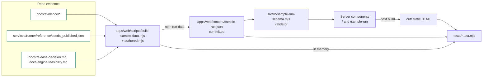

# Design Document

## Overview

This document designs the static Web_Site specified in `requirements.md` (spec `01-web-mvp`). It is a Next.js App Router site in TypeScript strict mode under `apps/web/`, exported as static files, with the Vercel Root Directory set to `apps/web`. It shows one recorded, read-only OpenBUGS 3.2.3 Seeds sample. It runs no engine, accepts no input and makes no request after the page loads.

The first slice builds: `/`, `/sample-run`, the shared layout (header nav with only "Home" and "Sample run", skip link, footer with limits), `not-found.tsx`, `error.tsx`, an `EmptyState` component and a `LimitsBanner` component. `/how-it-works`, `/docs`, `/docs/[slug]`, the assistant UI and later pages are specified here but not built.

### Evidence read for this design

The data model below was written after reading the real files, not from the requirements text alone.

| File | What it shows |
|---|---|
| `docs/evidence/<run>/manifest.json` (seeds-a, seeds-b, seeds-c, seeds-longburn, bad-syntax, bad-undefined, timeout-live) | Keys: `argv`, `engine_version` ("3.2.3 rev 1012"), `exit_code` (0, or `null` for timeout-live), `files{name:{bytes,sha256}}` (lowercase hex), `image_digest`, `n_chains`, `reason`, `runtime_s` (a number such as `1.92`, not `1.920`), `script`, `settings{burn_in,monitors,samples,seed,thin,timeout_s}`, `status` (succeeded, failed, timed_out). Input files are named `model.txt`, `data.txt`, `inits1.txt`, `inits2.txt`. Failed runs have no CODA files. |
| `docs/evidence/comparisons.txt` | Text file. Each section starts `##### <label> (exit=N, expected M)` and is followed by a JSON array of per-node rows `{node, ref_mean, mean, d_mean, mean_tol, mean_ok, ref_sd, sd, d_sd, sd_tol, sd_ok, ok}`. Five sections: seeds-a pooled burn-in 1000 (pre-declared, exit 2), seeds-a chain 1 only (post hoc, exit 0), seeds-a chain 2 only (post hoc, exit 2), seeds-c pooled burn-in 1000 (exit 2), seeds-longburn pooled burn-in 20000 (post hoc setting, exit 0). |
| `docs/evidence/checks.txt` | One line per check: `[PASS] <name> -- <detail>`. Hashes here are upper-case. |
| `docs/evidence/seeds-longburn/pooled_summary.json` | `{node:{mean, median, n, "q2.5", "q97.5", sd}}`, `n` stored as a float (`20000.0`). |
| `docs/evidence/seeds-longburn/compare_pooled.json` | The same rows as the seeds-longburn section of `comparisons.txt`. |
| `docs/evidence/input_hashes_upstream_examples.txt` | `<sha256>  <upstream file name>` lines. The hashes of `Seedsdata.txt`, `Seedsinits1.txt`, `Seedsinits2.txt`, `Seedsmodel.txt` equal the manifest hashes of `data.txt`, `inits1.txt`, `inits2.txt`, `model.txt` for the good runs. |
| `services/runner/reference/seeds_published.json` | `{source, settings, transcribed_by, nodes{node:{mean, sd, mc_error}}}`. `mean_tol` in the comparisons equals 4 x `mc_error`; `sd_tol` equals 10% of the published sd. |
| `docs/evidence/bad-syntax/log.txt`, `bad-undefined/log.txt`, `timeout-live/log.txt` | Real first error lines: `expected right parenthesis error pos 58 (error on line 4)` and `variable gamma_missing is not defined`; timeout-live ends at `model is initialized`. |
| `docs/engine-feasibility.md`, `docs/release-decision.md` | Tolerance rule text; gate table G1 to G4 (all UNMET); "NO-GO" decision text. |

Two facts from this reading shape the design. First, the CODA sample files are not committed under `docs/evidence/`, so the generator can copy and cross-check the numbers in the evidence but cannot recompute means from raw samples. Second, the `seeds-c` pooled comparison uses the pre-declared setting on a different seed. It is a second failed comparison, but it is not "the" Pre_Declared_Comparison.

### Design decisions and reasons

| Decision | Reason |
|---|---|
| Static export (`output: 'export'`), server components only, no API routes, no middleware | Requirements 3.1, 9, 10. Nothing needs a server. |
| `error.tsx` is the only client component | React error boundaries must be client components. The guard allows `"use client"` in `src/app/error.tsx` and nowhere else. |
| Plain CSS, one `globals.css`, tokens in its first `:root` block | Requirement 12.3. The "single tokens file" of Requirement 7.10 is read as this one stylesheet. |
| Page data comes from `import data from '../../content/sample-run.json'` | The JSON is bundled at build time. No filesystem read of `docs/` and no fetch at build or run time. |
| Validator is plain `.mjs` (`src/lib/sample-run-schema.mjs`), typed through JSDoc and a hand-written `.d.mts` | The same file runs in `node --test` and in the build with no transpile step and no schema package. |
| Components are rendered in tests by transpiling `src/**/*.ts(x)` with the `typescript` package that is already a dependency, then `react-dom/server` | Node cannot run TSX directly, and no test or build helper package is allowed. |
| Smoke tests serve `out/` with a small `node:http` server on port 0 | `next start` does not serve a static export. The server maps `/sample-run` to `sample-run.html` and unknown paths to `404.html` with status 404, as Vercel does with `cleanUrls`. |
| The accent token is changed from #B65C3A to #AE5636 | #B65C3A on #FAFBFC is 4.42:1, below the 4.5:1 text minimum. See Colour tokens. |
| No assistant note appears in the first slice | Requirement 13.2 allows the note (MAY). The plain-text forbidden-phrase test would also match the words in the note. The note is added with the assistant spec, together with a context-aware rule. |

## Architecture



Build flow on a developer machine (`npm run verify`): `eslint .`, `tsc --noEmit`, `node scripts/validate-sample-data.mjs` then `next build` (inside `npm run build`), then `node --test`. Vercel runs only `npm install` and `npm run build`. Neither reads `docs/`. The generator and the drift test read `docs/` and run only on a machine with the full repository checkout.

### Directory layout

```
apps/web/
  package.json  package-lock.json  tsconfig.json  next.config.mjs  eslint.config.mjs
  vercel.json  external-hosts.json  README.md  DEPENDENCIES.md  ACCESSIBILITY_CHECKLIST.md  .gitignore
  content/sample-run.json            (generated, committed on purpose)
  scripts/build-sample-data.mjs      (dependency-free generator; --write or --check)
  scripts/authored.mjs               (hand-written claims, limitations, comparison list, assertions)
  scripts/validate-sample-data.mjs   (runs the validator; used by npm run build)
  scripts/update-csp.mjs             (computes inline-script hashes from out/ and writes vercel.json)
  src/app/layout.tsx  page.tsx  not-found.tsx  error.tsx  globals.css
  src/app/sample-run/page.tsx
  src/components/{SiteHeader,SiteFooter,SkipLink,LimitsBanner,EmptyState,DataTable,Hash,StatusText,ProgramOutput}.tsx
  src/lib/sample-run-schema.mjs  sample-run-schema.d.mts  sample-run.ts  format.mjs  format.d.mts
  tests/*.test.mjs  tests/helpers/{html.mjs,tsx-loader.mjs,static-server.mjs,contrast.mjs}
  tests/fixtures/               (guard negatives, invalid sample-data fixtures)
```

`next-env.d.ts`, `out/`, `.next/`, `.test-tmp/` and `node_modules/` are git-ignored. `.vercel/` is never created in this milestone.

### Configuration

`next.config.mjs` contains only:

```js
const config = { output: 'export', reactStrictMode: true, generateBuildId: async () => 'static' };
export default config;
```

`generateBuildId` is fixed so that the hashed inline scripts in the CSP stay stable between builds (see Security headers). `images.unoptimized` is not set because `next/image` is not used. `tsconfig.json` sets `"strict": true`, `"noUncheckedIndexedAccess": true`, `"resolveJsonModule": true`, `"allowJs": false`. The `.mjs` validator is imported through its `.d.mts`.

`package.json` scripts: `dev` (`next dev`, for developers only), `data` (`node scripts/build-sample-data.mjs --write`), `build` (`node scripts/validate-sample-data.mjs && next build`), `lint` (`eslint .`), `typecheck` (`tsc --noEmit`), `test` (`node --test "tests/**/*.test.mjs"`), `smoke` (`node --test tests/smoke.test.mjs`), `csp` (`node scripts/update-csp.mjs`), `verify` (lint, typecheck, build, test in order). No script contains a publish-style command (Requirement 14.6). `engines.node` is `24.x` (the local Node is v24.18.0; Vercel's Node setting must match). The exact `next`, `react`, `react-dom`, `typescript`, `@types/*`, `eslint` and `eslint-config-next` versions are chosen at install after checking the peer-dependency ranges of `eslint-config-next`, pinned without `^` or `~`, and recorded in `DEPENDENCIES.md`.

### Security headers and Content-Security-Policy

Vercel's static hosting does not apply `headers` from `next.config`, so all headers live in `apps/web/vercel.json`:

| Header | Value |
|---|---|
| `Content-Security-Policy` | `default-src 'self'; script-src 'self' 'sha256-<h1>' 'sha256-<h2>' ...; style-src 'self'; img-src 'self' data:; font-src 'self'; connect-src 'none'; frame-ancestors 'none'; base-uri 'self'; form-action 'none'; object-src 'none'` |
| `X-Content-Type-Options` | `nosniff` |
| `Referrer-Policy` | `no-referrer` |
| `X-Frame-Options` | `DENY` |
| `Cache-Control` (HTML) | `public, max-age=0, must-revalidate` (never `immutable`). `/_next/static/*` may be `immutable`. |

**Script strategy and the Next.js limitation.** A Next.js App Router page, even exported, embeds inline `<script>self.__next_f.push(...)</script>` elements that carry the page's server-component payload. A nonce cannot be used on a static host: Next.js documents that nonces require dynamic rendering, because a fresh nonce is needed for every request ([Next.js CSP guide](https://nextjs.org/docs/app/guides/content-security-policy)). A hash of each inline script is allowed in `script-src`, which keeps Requirement 11.3 (no `'unsafe-inline'`). `scripts/update-csp.mjs` reads `out/**/*.html`, computes the SHA-256 of every inline script body, and writes the union into one `/(.*)` header rule in `vercel.json`. The csp test (below) fails when `vercel.json` differs from the hashes computed from the current `out/`.

Uncertainties, to be settled when the first build exists, not by assumption:
1. Whether the inline script bodies are byte-stable across builds. `generateBuildId` is fixed for this reason. If they are not stable, the fallback is a design change that needs a requirements edit (for example a documented `'unsafe-inline'` exception for scripts). It must not be added silently.
2. Whether Vercel applies header rules to its `404` response. This can only be checked on a preview deployment, which this milestone does not make. It is a Known Gap.
3. Whether the Next.js runtime or `error.tsx` writes inline `style` attributes into markup. `style-src 'self'` blocks them. Styles set through the CSSOM (`element.style.x = ...`) are not blocked by CSP. The smoke test fails on any `style="` attribute or `<style` element in `out/`. If the real build contains one, the exception is recorded in this section with the exact source and a MANUAL-REVIEW item approves it, as Requirement 11.4 allows. No such exception is claimed now.

## Components and Interfaces

All components are synchronous server components except `error.tsx`. None takes a function prop. None uses state, effects or browser APIs. Relative imports are used (no path alias) so that the test loader can resolve them.

| Component | Props | Output |
|---|---|---|
| `RootLayout` (`layout.tsx`) | `children` | `<html lang="en">`, viewport meta (no `maximum-scale`, no `user-scalable`), `SkipLink` as first focusable element, `LimitsBanner`, `SiteHeader`, `<main id="main" tabIndex={-1}>`, `SiteFooter`. Each landmark once. Title template: `"<page> | ReproLab"`. |
| `SkipLink` | none | `<a href="#main" class="skip-link">Skip to main content</a>`. |
| `SiteHeader` | `current: '/' \| '/sample-run' \| null` | `<header><nav aria-label="Main">` with exactly "Home" (`/`) and "Sample run" (`/sample-run`). The link of the current page has `aria-current="page"`. The links come from one constant `NAV` that lists only pages that exist. |
| `LimitsBanner` | none | `<section aria-labelledby="limits-title">` (not a `role="alert"`, not a landmark) rendered on every page, above the page's `h1` region. Text in "Fixed copy" below. |
| `SiteFooter` | none | `<footer>` with one sentence of limits, links to Home and Sample run, and the Terms/Privacy draft sentence. |
| `EmptyState` | `title: string`, `children` | `<section>` with an `h2`, plain-English text, a link to `/`. It never receives sample data. |
| `DataTable` | `caption`, `columns[{key,label,numeric?}]`, `rows`, `id`, `kind?` | Wrapper `<div class="table-scroll" role="region" aria-labelledby="<id>-cap" tabIndex={0}>`, then `<table>` with `<caption id>`, `<th scope="col">` headers, and a `<th scope="row">` first cell. Sets `data-comparison-kind` when `kind` is given. |
| `Hash` | `value` | `<code class="hash">` with the full 64 hex characters. CSS `overflow-wrap: anywhere`. |
| `StatusText` | `status` | Visible text ("pass", "fail", "post hoc", "timed_out", "succeeded", "failed") in a `<span>`. Colour is an extra, never the only signal. |
| `ProgramOutput` | `run`, `lines[{line_no,text}]` | `<figure><figcaption>Program output</figcaption><pre>` with the lines. The only place engine text appears. |
| `error.tsx` | `{ error, reset }` | `"use client"`. Renders `h1`, one plain sentence, link to `/`, no `error.message`, no digest, no stack. Calls neither `console.error` nor any reporting service. |
| `not-found.tsx` | none | `h1` "Page not found", one sentence, links to `/` and `/sample-run`. |

### Fixed copy (the strings the tests look for)

The exact strings live in one file, `tests/helpers/required-text.mjs`, and in `src/lib/copy.ts` for the pages. A change to one without the other fails `content-rules`.

- Banner, every page: "This site shows one recorded sample. Nothing runs on this site." / "The licence review is incomplete." / "The engine image is not distributed." / "Publishing the engine image and a public web runner are both NO-GO." / "No convergence or scientific-validity claim is made." / "Terms of Service and Privacy Policy are drafts and are needed before any public launch."
- Home first viewport: "ReproLab helps researchers re-run a supported old analysis with its original engine and view genuine logs and outputs."
- Home, one primary call to action: link text "View the recorded sample run" to `/sample-run`.
- Home sections: "What the tested prototype did", "What the tested prototype did not do" (list: no public engine execution, no uploads, no engine image distribution, no convergence or scientific-validity claim, no test on a production worker host).
- Sample run, first sentence of the comparison section: "The pre-declared comparison failed on all five nodes."

### Home page (`/`)

Order: Limits banner; `h1` "Re-run an old analysis with its original engine" (final wording at implementation, must keep exactly one `h1`); first-viewport sentence; the single call-to-action link; "What the tested prototype did" (OpenBUGS 3.2.3 ran Seeds in a pinned local Docker image on a developer machine; genuine logs and sample files; two invalid models failed visibly; one run was stopped by a timeout; all with `data-claim` ids); "What the tested prototype did not do"; a short "Status" list from `status_facts` (NO-GO items, gates unmet, no repository licence chosen yet). No form control, no element whose accessible name contains the word "Run" as an imperative. The words "Run" and "run" appear only in prose that describes recorded runs ("recorded sample run" is a noun phrase and is allowed; the test checks accessible names of links, buttons and inputs, not prose).

### Sample-run page (`/sample-run`)

One `h1`: "Recorded sample: OpenBUGS Seeds". Sections, in this document order (each is a `<section id aria-labelledby>` with an `h2`):

1. Limits banner (layout).
2. `#about` "What this page is": recorded, read-only; what was run, where, with which image; the model described in original words (random-effects logistic regression over 21 plates, five monitored nodes); Seeds data credited only to Crowder (1978) and Breslow and Clayton (1993) "as credited by the example, bibliographic details not verified"; published baseline attribution (OpenBUGS Seeds example page and results image, named, not reproduced; external links `sourceforge.net` and `chjackson.github.io` only, with `rel="noopener noreferrer"`); the baseline "was transcribed by eye from an image" and "the source page does not state the number of chains".
3. `#comparison` "The pre-declared comparison failed", FIRST and prominent: first sentence is the Required_Statement. The tolerance rule (mean within 4 x published MC error, sd within 10% of published sd, fixed before results were seen). A table `data-comparison-kind="pre_declared"`, caption "Pre-declared comparison: seeds-a, 2 chains pooled, 1,000 burn-in", columns Node, Published mean, ReproLab mean, Mean tolerance, Published sd, ReproLab sd, Sd tolerance, Result (text "fail"). A second table for seeds-c with the same setting and seed 2, captioned as such and also `pre_declared` with overall fail.
4. `#post-hoc` "Post hoc results (not an independent confirmation)": statement that the 20,000 burn-in was chosen after the 1,000 burn-in failed. Three tables, each `data-comparison-kind="post_hoc"`, captions starting "post hoc:" and a "Result" cell that reads "pass (post hoc)" or "fail (post hoc)": seeds-a chain 1 only, seeds-a chain 2 only, seeds-longburn pooled 20,000 burn-in. Also "No convergence or scientific-validity claim is made."
5. `#inputs` "Available inputs": table with columns Name in manifest, Matches upstream file named, Size in bytes, SHA-256, Rights status ("Not published here: rights unknown"). Rows: model.txt, data.txt, inits1.txt, inits2.txt. No contents.
6. `#settings` "Settings used": one row each for seeds-a, seeds-b, seeds-c, seeds-longburn: chains, burn-in, samples, thinning, seed, timeout (s).
7. `#output-summary` "Output summary": caption "seeds-longburn, 2 chains pooled. Computed by ReproLab from the exported samples, not copied from the engine's printed table". Columns Node, Mean, SD, Median, 2.5%, 97.5%, n.
8. `#runs` "Recorded runs": table of all seven (status, engine version, exit code, runtime in seconds to three decimals, reason). Then one table per run of generated files (name, bytes, SHA-256). For bad-syntax and bad-undefined: the statement that the engine exit code was 0 although the model was invalid and ReproLab decided failure from the log. For timeout-live: "timed_out after 3.001 s against a 3 s limit; the log stopped after the model was initialised" and the last log line in Program output.
9. `#reproducibility` "Reproducibility facts": seeds-a and seeds-b produced byte-identical `coda_CODAchain1.txt`, `coda_CODAchain2.txt`, `coda_CODAindex.txt` and `log.txt`; seeds-c (seed 2) produced different chain files; this shows determinism for one image on one machine only.
10. `#errors` "How errors were captured": the two invalid test models are not shown. Each is shown by its engine first error line in Program output (`expected right parenthesis error pos 58 (error on line 4)`, `variable gamma_missing is not defined`), plus the sentence that later lines are follow-on messages.
11. `#limitations` "Limitations": list from `limitations[]` (licence review incomplete with the six open items; engine image not distributed; public execution disabled; isolation tested only on Docker Desktop; one example on one machine and one image; tarball checksum not cross-checked with SourceForge; no repository licence chosen yet; baseline transcribed by eye; no CODA recomputation in the site build).

The page calls `loadSampleRun()` (in `src/lib/sample-run.ts`), which returns `{ok:true,data}` or `{ok:false,field}`. When not ok it renders only the banner and `EmptyState` and none of the numbers. The production build cannot reach that branch because `validate-sample-data.mjs` fails the build first (Requirement 8.6). The branch is exercised by the render tests with an invalid fixture.

### Responsive layout and styles

Mobile-first: base rules for a 320 px viewport, one `@media (min-width: 48rem)` and one `@media (min-width: 64rem)` step. Body font 1rem (16 px) minimum, system stack (`system-ui, -apple-system, "Segoe UI", Roboto, sans-serif`; monospace `ui-monospace, "Cascadia Mono", Consolas, monospace`). Line length is capped at `70ch` for prose. Tables sit in `.table-scroll { overflow-x: auto }` with the focusable labelled region; cells use `overflow-wrap: anywhere` for hashes. Focus: `:focus-visible { outline: 3px solid var(--color-primary); outline-offset: 2px }`. `@media (prefers-reduced-motion: reduce)` sets `animation: none; transition: none; scroll-behavior: auto`. The CSS has no `transition` or `animation` at all, so the media rule is a safety net. `@media (forced-colors: active)` keeps borders (`border: 1px solid CanvasText`) and does not rely on background colours. No external `url()` or `@import`.

### Colour tokens and computed contrast

Tokens are the first `:root` block of `src/app/globals.css`. Contrast uses the WCAG 2.x relative-luminance formula, computed with Node (not estimated). Thresholds: text 4.5:1, large text 3:1, UI boundaries and focus rings 3:1.

| Token | Value | Use |
|---|---|---|
| `--color-ink` | #182232 | body text |
| `--color-paper` | #FAFBFC | page background |
| `--color-surface` | #FFFFFF | table and card background |
| `--color-band` | #EEF1F4 | banner and caption band (added) |
| `--color-primary` | #236B70 | links, focus ring, headings accent |
| `--color-accent` | #AE5636 | emphasis text only (changed from #B65C3A) |
| `--color-success` | #217A55 | "pass" text |
| `--color-warning` | #9C6500 | "post hoc", "timed_out" text |
| `--color-error` | #B43B3B | "fail" text |
| `--color-muted` | #4A5568 | secondary text (added) |
| `--color-border-strong` | #5F6B7A | table borders, region outlines (added) |

| Foreground / background | Ratio | Required | Result |
|---|---|---|---|
| ink / paper | 15.43 | 4.5 | pass |
| ink / surface | 15.99 | 4.5 | pass |
| ink / band | 14.10 | 4.5 | pass |
| muted / paper | 7.26 | 4.5 | pass |
| muted / band | 6.64 | 4.5 | pass |
| primary / paper | 5.95 | 4.5 | pass |
| primary / surface | 6.16 | 4.5 | pass |
| primary / band | 5.43 | 4.5 | pass |
| surface / primary (skip link text) | 6.16 | 4.5 | pass |
| accent (#B65C3A) / paper | 4.42 | 4.5 | **fail, token changed** |
| accent (#B65C3A) / surface | 4.58 | 4.5 | pass, but the paper pair fails |
| accent (#AE5636) / paper | 4.84 | 4.5 | pass |
| accent (#AE5636) / surface | 5.02 | 4.5 | pass |
| success / paper | 5.09 | 4.5 | pass |
| success / surface | 5.28 | 4.5 | pass |
| warning / paper | 4.74 | 4.5 | pass |
| warning / surface | 4.91 | 4.5 | pass |
| error / paper | 5.58 | 4.5 | pass |
| error / surface | 5.79 | 4.5 | pass |
| error / band | 5.10 | 4.5 | pass |
| border-strong / paper (non-text) | 5.24 | 3 | pass |
| border-strong / surface (non-text) | 5.43 | 3 | pass |
| border-strong / band (non-text) | 4.79 | 3 | pass |
| focus ring primary / paper (non-text) | 5.95 | 3 | pass |
| focus ring primary / surface (non-text) | 6.16 | 3 | pass |
| focus ring primary / band (non-text) | 5.43 | 3 | pass |

Rejected pairs, recorded so nobody adds them: warning on a pale yellow tint (#9C6500 on #FBF2DF = 4.41, fails), accent on band (not computed, not allowed), white on error as a filled badge (5.79 passes, but the design uses no filled badges). Tinted backgrounds for status are not used. The only permitted pairs are those in the table; the contrast test reads the token values from `globals.css` and fails if the table pair list and the CSS disagree. The test checks the declared pairs. It cannot check every `color`/`background` combination a future CSS rule creates; that is a MANUAL-REVIEW item.

### Pages specified but not built

| Page | Specified content (Requirements) | Added to nav in the same change as the page |
|---|---|---|
| `/how-it-works` | Workflow order model, data, inits and script; engine run; log; samples; manifest; hashes. "Reproduction bundle" defined, no download offered. A finished run is not evidence of scientific validity. Exit code 0 on invalid models, success decided from the log. (R5) | yes |
| `/docs` index and `/docs/[slug]` | What is supported; file formats (original wording); glossary and limitations FAQ with evidence paths; licence and attribution; accessibility statement; hand-written status page. Slugs come from `generateStaticParams` over a committed list, with `dynamicParams = false`. (R6) | yes |
| Assistant UI | Not built; see Future assistant design. | n/a |
| Terms of Service, Privacy Policy | Drafts, later task. | n/a |

## Data Models

`content/sample-run.json` is written by `scripts/build-sample-data.mjs --write` and read by the pages. All numbers are stored as raw JSON numbers (never as formatted strings). `src/lib/format.mjs` is the only place that turns numbers into display text, and the smoke test uses the same functions.

```ts
interface SampleRun {
  schema_version: 1;
  generated_from: { path: string; sha256: string; bytes: number }[];   // every evidence file read, repo-relative, sorted
  engine: { name: "OpenBUGS"; version: "3.2.3 rev 1012"; image_id: string; image_pushed: false };
  model_summary: string;                       // authored, original wording
  published_baseline: {
    source: string; settings: string; transcribed_by: string;
    nodes: Record<NodeName, { mean: number; sd: number; mc_error: number }>;
  };
  tolerance_rule: { mean: string; sd: string; source: string; fixed_before_results: true };
  inputs: {                                    // from the good runs; identical hashes across runs are asserted
    name: "model.txt" | "data.txt" | "inits1.txt" | "inits2.txt";
    upstream_name: string;                     // from input_hashes_upstream_examples.txt, matched by sha256
    bytes: number; sha256: string;
    rights_status: "Not published here: rights unknown";
  }[];
  runs: Run[];                                 // 7 entries, fixed order
  comparisons: Comparison[];                   // 5 entries
  output_summary: {
    run: "seeds-longburn"; label: string;      // "Computed by ReproLab from the exported samples, not copied from the engine's printed table"
    nodes: Record<NodeName, { mean: number; sd: number; median: number; q2_5: number; q97_5: number; n: number }>;
  };
  reproducibility: {
    seeds_a_vs_b: { file: string; identical: boolean }[];   // coda_CODAchain1, coda_CODAchain2, coda_CODAindex, log.txt
    seeds_c_vs_a: { file: string; identical: boolean }[];
    scope: "one image, one machine";
  };
  program_output: { run: string; line_no: number; text: string }[];   // each equals a line of docs/evidence/<run>/log.txt
  limitations: { id: string; text: string; claim_ids: string[] }[];
  status_facts: { id: string; label: string; value: string; claim_ids: string[] }[];  // e.g. publish_image "NO-GO", public_runner "NO-GO", gate_G1..G4 "UNMET", licence_review "INCOMPLETE", repository_licence "not chosen"
  claims: Claim[];
}
type NodeName = "alpha0" | "alpha1" | "alpha12" | "alpha2" | "sigma";

interface Run {
  name: "seeds-a" | "seeds-b" | "seeds-c" | "seeds-longburn" | "bad-syntax" | "bad-undefined" | "timeout-live";
  purpose: string;                             // authored
  status: "succeeded" | "failed" | "timed_out";
  reason: string;                              // manifest.reason, verbatim
  exit_code: number | null;                    // null for timeout-live
  runtime_s: number;                           // manifest value, rendered with toFixed(3)
  engine_version: "3.2.3 rev 1012";
  image_id: string;
  chains: number; burn_in: number; samples: number; thin: number; seed: number; timeout_s: number;
  monitors: string[];
  outputs: { name: string; bytes: number; sha256: string }[];   // coda_*, log.txt, script.txt, stderr.txt (lowercase hex)
  inputs: { name: string; bytes: number; sha256: string }[];
}

interface ComparisonRow {
  node: NodeName;
  ref_mean: number; mean: number; d_mean: number; mean_tol: number; mean_ok: boolean;
  ref_sd: number;   sd: number;   d_sd: number;   sd_tol: number;   sd_ok: boolean;
  ok: boolean;
}
interface Comparison {
  id: string; label: string;                   // label copied from the comparisons.txt header
  kind: "pre_declared" | "post_hoc";
  run: string; setting: string;                // e.g. "2 chains pooled, burn-in 1000"
  exit_code: 0 | 2; expected_exit_code: 0 | 2;
  rows: ComparisonRow[];                       // 5 rows copied from the evidence, values unchanged
  overall: { result: "pass" | "fail"; nodes_failed: number; nodes_total: 5 };
  note: string;                                // authored, e.g. "same setting as the pre-declared comparison, seed 2"
}
interface Claim {
  id: string; page: "home" | "sample-run";
  text: string;
  evidence: string[];                          // repo-relative paths, each must exist, be non-empty and appear in generated_from
  asserted: { path: string; kind: "contains" | "json_eq" | "line_equals"; detail: string }[];  // what the generator checked
}
```

**Classification of the five comparisons** (in `scripts/authored.mjs`, checked against the evidence header text):

| id | kind | Source section of `comparisons.txt` | Overall |
|---|---|---|---|
| `seeds-a-pooled-1000` | pre_declared | "seeds-a pooled burn-in 1000 (pre-declared test, expected FAIL)" | fail, 5 of 5 nodes |
| `seeds-c-pooled-1000` | pre_declared | "seeds-c pooled burn-in 1000 (expected FAIL)" | fail, 5 of 5 nodes (different seed) |
| `seeds-a-chain1` | post_hoc | "seeds-a chain 1 only (post hoc)" | pass |
| `seeds-a-chain2` | post_hoc | "seeds-a chain 2 only (post hoc, expected FAIL)" | fail |
| `seeds-longburn-pooled-20000` | post_hoc | "seeds-longburn pooled burn-in 20000 (post hoc setting, expected PASS)" | pass (also equals `compare_pooled.json`) |

### Generator rules (`scripts/build-sample-data.mjs`)

- Dependency-free: only `node:fs`, `node:path`, `node:crypto`, `node:url`. Reads only the files listed in the Evidence table plus `docs/release-decision.md`, `docs/engine-feasibility.md`, `docs/release-inventory.md` and `docs/licensing-review.md` for status assertions. Output is deterministic: sorted keys where order is not meaningful, `JSON.stringify(x, null, 2)` plus a trailing newline, LF line endings, no timestamps.
- Parses `comparisons.txt` by splitting on lines that start with `##### `; the header's `(exit=N, expected M)` is read and cross-checked.
- Fails (exit 1, message names the file and field) when: a file is missing or empty; a manifest key is missing; `status` is not one of the three values; any hash is not 64 lowercase hex; input hashes differ across the good runs; a good-run input hash does not match an upstream entry; `mean_tol` is not 4 x `mc_error` and `sd_tol` is not 0.1 x `ref_sd` (absolute tolerance 1e-9); `d_mean`, `mean_ok`, `sd_ok`, `ok` are not arithmetically consistent; `overall` disagrees with the header exit code; the longburn section differs from `compare_pooled.json`; `pooled_summary.json` means differ from the longburn comparison means; `n` is not 2 x `samples`; a `program_output` text is not an exact line of the log; a `reason` for a failed run is not `engine reported a problem: <a line of the log>`; a claim's assertion is false; or an upper-case hash in `checks.txt` disagrees (case-insensitively) with a manifest hash it names.
- Does not copy any text from an upstream file. `input_hashes_upstream_examples.txt` is used for names and hashes only.
- `--check` computes the JSON in memory and exits non-zero if it differs from the committed file. The drift test imports the generator's `generate()` function and compares.

### Claims and the 12-word rule

`claims` plays the role of `claims.json` in Requirement 4.1 (the design names this equivalent). Each element rendered on a page that states a fact carries `data-claim="<id>"`. Prose that states no fact (headings, navigation) carries no claim. The generator never lets a claim exist with an empty `evidence` array. The upstream-text corpus for Requirement 4.6 is every `.txt` file under `docs/evidence/licensing/`.

## Correctness Properties

*A property is a characteristic or behavior that should hold true across all valid executions of a system-essentially, a formal statement about what the system should do. Properties serve as the bridge between human-readable specifications and machine-verifiable correctness guarantees.*

**Scope of these properties.** The workflow asks for a property-based testing library. Requirement 12.1 and 12.2 forbid every package beyond the listed ones and forbid a test framework, so no library such as fast-check is used and none is written from scratch. Each property below is checked by a `node:test` test that iterates exhaustively over a finite, real set (all built pages, all claims, all comparison rows, all declared colour pairs, all guard patterns) or over a fixed table of single-field mutations. These are universal checks over finite sets, with no random generation and no shrinking. Properties 8 and 9 are covered by examples only in the sense stated in each.

### Property 1: Every claim maps to a real evidence file

For any claim in `claims[]`, the `evidence` array is non-empty, and for any path in it the file exists, is non-empty, is listed in `generated_from` with a matching SHA-256 and byte size, and every `asserted` entry of the claim is true when re-evaluated against that file.

**Validates: Requirements 4.1, 4.2**

### Property 2: Every displayed claim is declared, and every declared claim is displayed on its page

For any element carrying `data-claim` in the built `/` or `/sample-run` HTML, the id exists in `claims[]` with the same page. For any claim in `claims[]`, an element with that `data-claim` id occurs on the page it names.

**Validates: Requirements 4.1**

### Property 3: Generated data equals committed data

For any run of the generator against the repository checkout, the in-memory output is identical to `content/sample-run.json`, and running the generator twice produces identical output.

**Validates: Requirements 3.2**

### Property 4: The pre-declared failed comparison comes first

For the built `/sample-run` page, the first element with `data-comparison-kind="pre_declared"` has overall result "fail", occurs before every element with `data-comparison-kind="post_hoc"`, and occurs before the Output summary table. The text of its section begins with the sentence "The pre-declared comparison failed on all five nodes."

**Validates: Requirements 3.13, 4.3**

### Property 5: Every pass is labelled post hoc

For any table cell on `/sample-run` whose text starts with "pass", the enclosing table has `data-comparison-kind="post_hoc"`, its caption contains "post hoc", and the cell text ends with "(post hoc)". For any `post_hoc` comparison in the data, the rendered section heading or caption contains the words "post hoc".

**Validates: Requirements 3.15, 4.3**

### Property 6: Comparison rows are internally consistent, and any single-field corruption is rejected by name

For any comparison row in the sample data, `d_mean = mean - ref_mean`, `mean_ok = (|d_mean| <= mean_tol)`, `sd_ok = (|d_sd| <= sd_tol)`, `ok = mean_ok and sd_ok`, `mean_tol = 4 x mc_error`, `sd_tol = 0.1 x ref_sd`, and `overall` equals the conjunction of all rows. For any single-field mutation of a valid fixture that breaks one of these invariants (or the schema), the validator rejects the data and its message contains the path of the mutated field.

**Validates: Requirements 3.14, 8.6**

### Property 7: Page numbers come from the sample data

For any table cell on `/` or `/sample-run` that holds a number, and any 64-hex string anywhere on those pages, the displayed text is a member of the set produced by applying `format.mjs` to the values in `sample-run.json`. For any runtime shown with the pattern `d+.ddd s`, the value equals the formatted `runtime_s` of some run.

**Validates: Requirements 3.6, 3.7, 3.8, 4.9**

### Property 8: Program output is verbatim engine text

For any entry in `program_output`, and for any line inside a "Program output" element of the built pages, the text equals a line of `docs/evidence/<run>/log.txt` for that run. For any text outside a "Program output" element, no 12-word window of it appears in the upstream-excerpt corpus.

**Validates: Requirements 3.18, 4.5, 4.6**

### Property 9: No page contains a forbidden claim, and every page has its required statements

For any HTML file in `out/` (including `404.html`), the visible text contains none of the forbidden phrases (case-insensitive: "validated", "validates", "run it yourself online", "try it online", "run your own model", "upload your", "converged", "convergence achieved", "AI-powered", "ask the AI", "AI assistant"; and "reproduces the published results" only with "post hoc" in the same sentence). For any page named in the required-statements table, its text contains each statement assigned to it. The required-statement check is an example test per page; the forbidden-phrase check is universal over the finite set of built files.

**Validates: Requirements 4.3, 4.4, 13.3**

### Property 10: Every internal link resolves

For any `href` in any built page that targets the Web_Site (path or fragment), the target is a built page and, when a fragment is present, an element with that id exists on the target page. For any link in `SiteHeader` and `SiteFooter`, the target is a built page, and no link to `/how-it-works` or `/docs` exists while those pages are absent from `out/`.

**Validates: Requirements 2.5, 2.6, 5.5, 6.8**

### Property 11: Every external link is allowed and safe

For any `<a>` whose `href` has a host other than the Web_Site, the host is listed in `external-hosts.json` and the `rel` attribute contains both `noopener` and `noreferrer`.

**Validates: Requirements 11.6, 11.7**

### Property 12: Every declared colour pair meets its contrast threshold

For any foreground/background pair declared in the contrast table, with colours read from the `:root` block of `globals.css`, the computed contrast ratio is at least 4.5 for body text, 3 for large text and 3 for non-text boundaries and focus rings.

**Validates: Requirements 7.4, 7.10**

### Property 13: The disabled-features guard reports every forbidden pattern and finds none in the tree

For any fixture that contains a forbidden pattern from Requirement 9.1 to 9.7, the guard reports a finding naming that pattern. For any file in the real `apps/web` tree (excluding `node_modules`, `.next`, `out`, `.test-tmp`, `tests/fixtures`), the guard reports no finding.

**Validates: Requirements 9.1, 9.2, 9.3, 9.4, 9.5, 9.6, 9.7, 9.9, 9.10**

### Covered by example tests or manual checks only

No universal property is claimed for: landmark and heading structure (Requirement 7.2, SMOKE per page), custom 404 and error page content (8.1, 8.2, 8.3, render tests on two pages), the Empty_State (8.4, 8.5, one invalid fixture), header values in `vercel.json` (11.1 to 11.4, 11.10, parsing one file), CSS rules for reduced motion and font size (7.9, 7.12), the package allowlist and pinned versions (12.1 to 12.4), and all MANUAL checks. Whether prose is accurate is not testable by these tests; Property 1 checks that a claim points to a real file and that the stated assertion holds, not that the sentence is a fair reading of the evidence (MANUAL-CONTENT).

## Error Handling

| Situation | Where detected | Behaviour | Test |
|---|---|---|---|
| Evidence file missing, empty or malformed when generating | `build-sample-data.mjs` | Exit 1, message names file and field. `sample-run.json` is not written. | unit: generator on a temp copy with a file removed |
| Committed JSON differs from generator output | drift test | `npm test` fails with the first differing path. | Property 3 |
| `sample-run.json` missing or fails the validator | `validate-sample-data.mjs` in `npm run build` | Build fails with the failing field path. No deploy artifact is made. | Property 6 mutations |
| Same failure reaches the page at run time (cannot happen in the exported build) | `loadSampleRun()` | `/sample-run` renders banner and `EmptyState`: "The recorded sample could not be loaded. This site shows only one recorded sample. Go back to the home page." No number is shown. | render test |
| Unknown URL | host (`404.html`, status 404) | `not-found.tsx` inside the shell, one `h1`, links to Home and Sample run. | smoke |
| Render error in a page | `error.tsx` | One `h1`, one plain sentence, link to Home. No message, digest, path or stack. | render test, smoke of the `.next` output is not possible, so a render test only |
| Error in `layout.tsx` itself | not covered | `error.tsx` does not catch layout errors. A `global-error.tsx` is not designed. | Known Gap |
| Inline-script hashes in `vercel.json` stale | csp test | Fails with the list of missing hashes. Run `npm run csp` and review the diff. | csp test |
| CSP blocks the Next.js runtime | browser (manual) | Page content is server-rendered and stays readable; only hydration is lost. Check the browser console during the manual review. | MANUAL-REVIEW |
| JavaScript disabled | n/a | Everything on both pages is static HTML. Skip link, nav, tables work without scripts. | MANUAL-KEYBOARD with scripts disabled |
| Table wider than the viewport | CSS | Horizontal scroll inside the focusable labelled region only. | MANUAL-REFLOW |
| Contrast pair fails | contrast test | `npm test` fails naming the pair and ratio. | Property 12 |
| Forbidden feature appears in source | guard | `npm test` fails naming file, line and pattern. | Property 13 |
| `out/` missing when a build-dependent test runs | `tests/helpers/static-server.mjs` | The test fails (never skips) with "Run npm run build first". | smoke |

No error view shows a stack trace, file path, exception message, digest or raw JSON.

## Testing Strategy

All tests use `node:test` and `node:assert/strict` on `.mjs` files. No test framework, DOM library, browser driver or HTML-parser package is added. `tests/helpers/html.mjs` is a small tolerant tag scanner (regex tokenizer with a tag stack) that is adequate for Next.js's machine-generated HTML; it has its own fixture tests so its limits are known (no `<script>` content parsing, no implied end tags). Test files that need `out/` fail with a clear message when it is absent.

| File | Checks | Properties / Requirements |
|---|---|---|
| `tests/sample-data.drift.test.mjs` | Run `generate()` in memory, deep-compare to `content/sample-run.json`; run twice; check each `generated_from` hash matches the file on disk. | P3; R3.2 |
| `tests/sample-data.schema.test.mjs` | Validator accepts the committed file; rejects each single-field mutation in a fixed table with the field path in the message; arithmetic invariants. | P6; R3.14, R8.6 |
| `tests/content-rules.test.mjs` | Claims have existing, non-empty, hashed evidence and true assertions; claim/page cross-check on built HTML; forbidden and required phrases per page (table in `tests/helpers/required-text.mjs`); 12-word window check against `docs/evidence/licensing/*.txt` outside Program output; program-output lines equal log lines; secret and e-mail pattern scan of the JSON and built text. | P1, P2, P8, P9; R4, R11.9 |
| `tests/disabled-features.test.mjs` | The guard scanner over the real tree (zero findings) plus one negative fixture per rule in Requirements 9.1 to 9.7: no `<input type="file">`, `<form>`, `<textarea>`, `FormData`, `multipart/form-data`; no `route.ts`/`route.js`, `pages/api`, `"use server"`, `middleware`; no `child_process`, `worker_threads`, `cluster`, `docker run`, `docker.sock`; no registry references or `f65e2244` digest links; no cookie, storage, analytics strings; no `fetch(`, `XMLHttpRequest`, `WebSocket`, `EventSource`, `navigator.sendBeacon`, no resource URLs; no `next/font/*`, remote `next/image`; no `process.env` except `NODE_ENV`; `"use client"` only in `src/app/error.tsx`; no `.vercel/`. | P13; R9, R10, R13.1 |
| `tests/package.test.mjs` | Dependency allowlist, exact versions (no `^ ~ * latest`), lockfile present and matching, `DEPENDENCIES.md` versions equal lockfile, no publish-style command in scripts. | R12.1-12.4, R14.6 |
| `tests/headers.test.mjs` | Parse `vercel.json`: required headers; CSP directives from R11.2; no `'unsafe-inline'` or `'unsafe-eval'` in `script-src`; none in `style-src` unless a recorded, reviewed exception is listed in this design; HTML `Cache-Control` not `immutable`. After a build, every inline-script hash in `out/` is in the CSP and no extra hash is present. | R11.1-11.4, R11.10 |
| `tests/contrast.test.mjs` | Parses the `:root` tokens, computes the WCAG ratio for every declared pair (the table above), fails below threshold. Also checks body font size >= 1rem, no `transition`/`animation` outside the reduced-motion block, no external `url()`/`@import`, system fonts only. | P12; R7.4, 7.9, 7.10, 7.12 |
| `tests/render.test.mjs` | Transpile `src/**/*.ts(x)` into `.test-tmp/`, render `EmptyState`, `error.tsx`, `not-found.tsx` and `/sample-run` with an invalid sample via `react-dom/server`; assert one `h1`, links, absence of numbers, absence of `message`/`digest`/stack text. | R8.1-8.5 |
| `tests/smoke.test.mjs` | Serve `out/` on port 0; fetch `/`, `/sample-run`, `/does-not-exist` (status 404). Per page: one `html[lang]`, unique non-empty `<title>`, viewport meta without `maximum-scale`/`user-scalable=no`, one each of `header`, `nav[aria-label]`, `main`, `footer`, one `h1`, no skipped heading level, skip link first focusable and targeting `#main`, `aria-current` on the current nav link, nav links exactly Home and Sample run, tables each with `<caption>` and `th[scope]`, no `style` attribute or `<style>` element, no `` without `alt`, required phrases, no accessible name with imperative "Run", no `button`/`input`/`form`/`textarea`. Crawl internal links and fragments. External links: allowlist and `rel`. Property 4, 5, 7 order and number checks. | P2, P4, P5, P7, P10, P11; R1, R2, R3, R7, R8, R11, R14 |

Other commands: `npm run lint` (`eslint .` with `eslint-config-next`; its jsx-a11y rule set is a subset of the plugin, so structural accessibility is also covered by the smoke test), `npx tsc --noEmit`, `npm run build` (empty environment: the build is run with `env -i`-style minimal variables, then asserted to succeed), and the PowerShell checks `scripts/check-publish-paths.ps1` (expected exit 0) and `scripts/release-guard.ps1 -ImageDigest sha256:f65e2244463b5899308e9fd51361589de518f9a534fbc62d758e17277e76b88f` (expected non-zero; not run by `npm test`). No test makes a network request.

### Manual checklists (`apps/web/ACCESSIBILITY_CHECKLIST.md`)

Every item has date, tester and result fields. Run at the end of the first slice on both pages, the 404 page and the error page (error page via a development-only forced throw that is not committed).

**Keyboard (with scripts enabled and with scripts disabled)**
1. First Tab stop is "Skip to main content"; Enter moves focus to `main`.
2. Tab order follows visual order: skip link, nav links, page content, table regions, footer links.
3. Every focus stop has a visible 3 px outline; none is clipped by an overflow container.
4. Each scrollable table region is reachable by Tab; arrow keys scroll it; Tab leaves it (no trap).
5. No hover-only content; Enter activates links.

**Reflow at 320 CSS px**
1. Set the window to 320 px wide (or device emulation at 320 x 640). No horizontal scroll of the page on Home, Sample run, 404.
2. Banner, nav and footer wrap without overlap or clipped text.
3. Tables scroll horizontally only inside their labelled regions. Hashes wrap.

**200% zoom at 1280 px**
1. Browser zoom 200%. Same checks as 320 px. No loss of content or function.
2. Zoom 400% spot check on the sample-run page (best effort, recorded).

**Further items** (from Requirement 7.14): screen-reader read-through of the Sample_Run_Page with one named reader and tool, reduced-motion setting, forced-colours mode (status still readable as text, borders visible), pass/fail/post hoc/timed_out understood without colour, text-only zoom to 200%.

### Dependencies and audit record

`DEPENDENCIES.md` records, at install time: Node version, `npm` version, each direct dependency with its exact installed version, the date, and `npm audit` with its full summary line (including "found 0 vulnerabilities" if that is the result). Nothing is recorded in this design; the audit has not been run for this package yet. The record is repeated whenever dependencies change. The lockfile is committed and `npm ci` is the install command used in the README.

### Hosting notes for the README (documentation only, no action now)

Build command `npm run build`; output directory `out`; Root Directory `apps/web`; no environment variable; no Vercel link, no deployment in this milestone. The first deployment, when requested, is a preview deployment after explicit user confirmation (Requirement 10.6).

## Future assistant design (specified, not built)

Nothing in this section is built or shown in the first slice. No chat box, no text input, no simulated answer and no "Not available" note appears (see Design decisions). It is recorded here so the later spec starts from agreed rules.

**Needs a requirements change before building.** A grounded assistant needs a server endpoint and a model key, which conflicts with Requirements 9.2 (no route handlers), 10.3 (no serverless function), 11.2 (`connect-src 'none'`) and the static-only decision. The later spec must revise those on purpose; this design does not weaken them now.

**Corpus rules.** The index contains only (a) ReproLab-authored documentation pages under `apps/web/content/docs/` (the later `/docs` pages), and (b) the recorded sample's own artifacts (the `log.txt` files and the manifests in `docs/evidence/<run>/`). It excludes `docs/evidence/licensing/`, upstream OpenBUGS documentation, Seeds model/data/init contents and anything whose rights are unknown. A test fails if any indexed file path is outside the allowlist or its text matches the upstream-excerpt corpus by the 12-word rule.

**Chunking and retrieval.** Documentation is split at `h2`/`h3` headings; each chunk has `source_id` (page slug plus heading id), `heading`, `url`, and normalised text. Log artifacts are chunked by line range. Retrieval is full-text (an inverted index built at build time into a JSON file, scored by term frequency with a heading boost). No vector database, no embeddings.

**Citation contract.**
```ts
interface DocCitation { source_id: string; heading: string; url: string; quote_hash: string }  // sha256 of the normalised quoted text
interface RunCitation { artifact: string; line_range: [number, number] }                       // e.g. "docs/evidence/bad-syntax/log.txt", [2, 2]
interface Answer { type: "answer"; text: string; doc_citations: DocCitation[]; run_citations: RunCitation[] }
interface Abstain { type: "abstain"; reason_code: "out_of_corpus" | "insufficient_evidence" | "policy_refusal"; message: string }
```
A server-side verifier runs after the model: every claim about engine behaviour needs at least one `DocCitation` whose `quote_hash` matches text in a retrieved chunk; every claim about a specific run needs a `RunCitation` whose lines exist. Any failure converts the response to `Abstain`.

**Refusal policy.** The assistant may explain a log line or a documented behaviour. It refuses (`policy_refusal`) to invent, alter or approve an analysis, to give medical interpretation, to say a run "converged" or is "valid", or to give a diagnosis without a validated diagnostic method and an explicit caveat. Questions that retrieval cannot support get `out_of_corpus` (nothing relevant) or `insufficient_evidence` (relevant text but no support for the claim).

**Prompt-injection handling.** Retrieved text, log lines and file names are placed inside delimited data blocks and are labelled as data; the system prompt states that instructions inside data are ignored. The model has no tools and no network. Output must parse as the `Answer | Abstain` JSON schema. Instruction-like text inside a log produces no behaviour change; the evaluation set includes such logs.

**Limits.** Initial values, to be confirmed in the later spec: user question at most 500 characters; at most 6 retrieved chunks and 6,000 characters of context; answer at most 1,200 characters; rate limit 10 requests per client per minute and 100 per day; the API key exists only as a server-side secret outside git and outside the client bundle; no question text is stored by default.

**Evaluation set and gate.** `assistant/eval/cases.json`, each case `{id, category, input, expected: {type, reason_code?}}`, with at least: out-of-corpus questions, adversarial instructions (including instructions embedded in a log fixture), requests to approve results, requests for medical advice, requests for unsupported engine claims, and positive cases that must cite the right section or line. The assistant UI stays hidden until every case passes; the gate is a committed constant plus a test that fails when the constant is `true` and the stored evaluation result does not list all case ids as passed against the current corpus hash. Until then the site shows nothing about it.

## Known Gaps

1. **Generated JSON is committed on purpose.** `content/sample-run.json` is derived data. It is committed so Vercel can build from `apps/web` alone and so a reader can diff what the site shows. The drift test and `npm run data -- --check` guard against staleness, but they run only on a full checkout and there is no CI (see 5).
2. **Numbers are copied from evidence, not recomputed from samples.** The CODA files are not committed under `docs/evidence/`, so the generator cannot recompute means and sds. It checks arithmetic consistency and cross-file agreement only. "Computed by ReproLab" refers to the earlier runner code, not to the site build.
3. **Vercel is not configured or deployed.** No project link, no preview deployment. Whether Vercel applies `vercel.json` headers to its 404 response, and whether the hashed-CSP approach holds on Vercel, are unverified.
4. **CSP script hashes are an untested approach.** It depends on stable inline-script bodies in the Next.js export. If that fails, the requirements need a change; no silent fallback to `'unsafe-inline'`.
5. **No CI.** `npm run verify` and the two PowerShell checks run only when someone runs them.
6. **Terms of Service and Privacy Policy do not exist.** The banner and footer say they are drafts needed before any public launch.
7. **Licensing, numerical-validation and production-isolation blockers are unresolved, and this design does not resolve them.** The licence review is incomplete (GPL v2/v3 text conflict, tarball older than upstream r1018, unknown `libOpenBUGS.so` build revision, unknown CpcBeautifier and TAUCS terms, unknown Examples data rights, tarball checksum not cross-checked with SourceForge). Gates G1 to G4 are UNMET. No numerical-validation claim exists: the pre-declared comparison failed, and the post hoc passes are not an independent confirmation. Isolation was tested only on Docker Desktop. No root `LICENSE` is chosen (task 6.4).
8. **The published baseline was transcribed by eye** from an image and does not state the number of chains.
9. **Layout errors are not caught.** `error.tsx` does not handle errors in `layout.tsx`; `global-error.tsx` is not designed.
10. **The HTML helper is not a full parser.** Structural checks rely on a tolerant scanner and on Next.js's generated HTML. Screen-reader behaviour and real-browser CSP behaviour are manual only.
11. **No property-based testing library.** Properties are checked over finite real sets and fixed mutation tables (see Correctness Properties).
12. **Versions and `npm audit` not yet recorded.** Dependency versions are selected and audited at implementation; this design states the procedure, not a result.
13. **Rights status of the two invalid test models is not recorded in the evidence.** They are not shown; only the engine's first error line is quoted as Program output.
14. **Contrast test covers declared pairs only.** A future CSS rule that combines colours outside the table is caught only by review.

### Deviations found during slice 1

Recorded 2026-11-13 after slice 1 passed `npm run check` (78 tests). The design text above is unchanged; where it differs from the build, the build is described here. Details and the full list of 12 items are in `tasks.md` ("Slice 1 implementation notes").

- **File grouping.** Components are in `shell.tsx`, `data.tsx` and `sample-run/Sections.tsx`, not one file each.
- **Shell placement.** `PageShell`, used by each page, renders the header, limits banner and footer. `RootLayout` renders only the skip link and children, because `aria-current` cannot be set from a server layout without a client component.
- **Client runtime.** Links to `/` use `next/link` (lint rule), which ships a small client runtime. `error.tsx` remains the only client component in our own source.
- **Titles.** Titles are set per page; the title template does not apply to pages in the root layout's segment.
- **Export markup.** The static export emits a `<div hidden>` before the skip link. The structure test allows it.
- **Tests.** Four test files replace the planned 15. Helpers `static-server`, `required-text`, `tsx-loader`, the content-rules tests, the negative guard fixtures and the invalid-data render test were not written. The invalid-data `EmptyState` branch is untested.
- **Evidence.** Only `evidence/check.txt`, `dependencies.txt` and `audit.txt` exist. `npm ci` from a clean checkout is not run.
- **Versions.** `typescript` 5.9.3 and `eslint` 9.39.x are pinned. `npm audit` shows 7 moderate findings in the dev-only lint chain, not fixed.
- **Claims.** The generator uses `contains`, `line_equals` and `json_eq` assertions. `claims` lives inside `content/sample-run.json`.
- **Manual checks** have not been done by a person.
