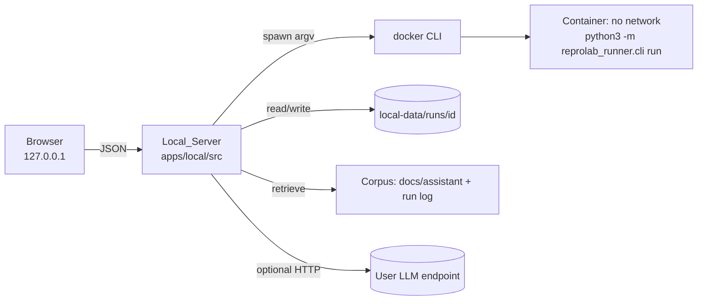
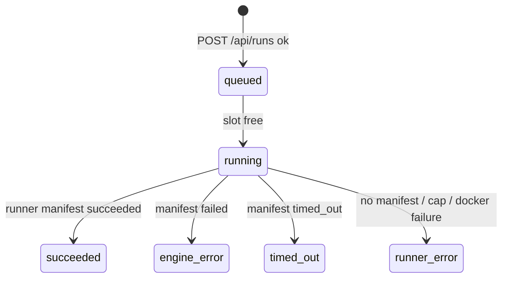

# Design Document

## Overview

`apps/local` is a dependency-free Node 24 program that serves a plain HTML/CSS/JS interface and a small JSON API on `127.0.0.1`. It runs OpenBUGS only through the pinned local Worker_Image, using `child_process.spawn` with argument arrays. It reuses the Python Runner already inside the image for staging checks, script generation, success classification (`classify()`), manifest writing and CODA summaries. No new Python runs on the host. `apps/web` is untouched except for optional static pages (Requirement 16).

Decisions and reasons:

| Decision | Reason | Rejected alternative |
|---|---|---|
| Separate `apps/local` | `apps/web` guard forbids `child_process` and `fetch` (spec 01-web-mvp Req 9) | Adding an API to `apps/web`: breaks the guard and Vercel static export |
| `docker create` + `docker cp` in/out + `docker start -a` | No host bind mount for writes; engine cannot seek on Windows bind mounts (`adapter.py` header) | `docker run -v host:/work`: seek failure on WSL/Windows mounts, host exposure |
| Reuse Runner CLI inside image | One implementation of limits, script generation and `classify()` | Re-implement in JS: two classifiers could disagree |
| Duplicate range checks in JS | Reject before any container starts (Req 4.5); a test pins both to the same ranges (Req 4.9) | Rely on Runner errors: slow, less readable |
| Lexical BM25 over small authored corpus | Dependency-free, deterministic, inspectable; steering forbids a new search index without measured need | Embeddings or a vector store |
| Server verifies citations, not the model | The model is untrusted text | Trusting model self-reports |
| No Correctness Properties section | Dependency-free rule excludes a property-testing library, and the project does not hand-roll one. Pure logic is covered by table-driven boundary tests and fixed-seed mutation loops (see Testing Strategy) | fast-check as a dependency |

Timeout note: the Runner accepts 1 to 3600 s; the local UI and API cap at 300 s (Req 4.1). The coin demo needs a few seconds; Seeds took about 1 s per 10,000 updates in recorded evidence.

Research basis (read, not fetched): `adapter.py` (limits, `classify`, manifest keys), `cli.py` (`run`, `summarize`), `coda.py`, `scripts/run-container.ps1` (the container flags and the create/cp/rm pattern), `docs/evidence/seeds-a/script.txt` (generated engine script), `infra/openbugs/Dockerfile` (`/work` owned by uid 10001, runner at `/opt/reprolab`).

## Architecture



Run lifecycle (one at a time):



Container sequence per Run (all `spawn(docker, [...])`):
1. `docker create --name rl-<id> --label reprolab.run=<id> --platform linux/amd64 --network none --read-only --cap-drop ALL --security-opt no-new-privileges --pids-limit 128 --memory 1024m --cpus 1 --tmpfs /tmp --user 10001 -v /work -e REPROLAB_IMAGE_DIGEST=<id> <image> python3 -m reprolab_runner.cli run --model /work/in/model.txt --data /work/in/data.txt --inits /work/in/inits1.txt ... --monitor ... --burn-in N --samples N --thin N --seed N --timeout N --out /work/out`
2. `docker cp <staging>/. rl-<id>:/work/in` (staging is a server-created temp dir under `local-data/tmp/<id>`, deleted afterwards; it holds only the fixed-name inputs).
3. `docker start -a rl-<id>` with a server cap timer (timeout + 30 s) that calls `docker kill rl-<id>`.
4. `docker cp rl-<id>:/work/out/. local-data/runs/<id>/`.
5. If succeeded: a second short-lived container (same flags, label, unique name) is created with command `python3 -m reprolab_runner.cli summarize --dir /work/in`; the `coda_*` files are copied in with `docker cp`, the container is started attached, and its JSON stdout is stored as `summary.json` in the Run_Dir. This container is also removed in `finally`.
6. `docker rm -f -v rl-<id>` in a `finally` for every container created.

Open risk to verify in task 5.2: files copied by `docker cp` into the volume may be owned by root; the runner only needs read access to `/work/in`, and creates `/work/out` itself in the uid 10001-owned volume root. If not, create `/work/out` ownership explicitly via a tar header.

### Directory layout

```
apps/local/
  package.json            no dependencies; scripts: start, test
  src/server.mjs          http server, routing, headers, host/origin checks
  src/validate.mjs        Run_Request schema and limits (pure)
  src/runs.mjs            queue, states, Run_Dir, manifest build
  src/docker.mjs          the only module that imports node:child_process
  src/sanitize.mjs        Host_Path replacement, name checks (pure)
  src/demos.mjs           demo catalogue, upstream presence check
  assistant/corpus.mjs    passage splitting, run passages
  assistant/retrieve.mjs  BM25, threshold, top-k (pure)
  assistant/provider.mjs  OpenAI-compatible client, env config
  assistant/answer.mjs    prompt build, citation verification (pure)
  public/                 index.html, app.js, styles.css, pages/*.html
  tests/                  *.test.mjs, helpers/fake-provider.mjs
docs/assistant/*.md       authored passages
examples/reprolab/coin/, coin-invalid/
local-data/               gitignored: runs/, tmp/, upstream/
vendor/                   gitignored: OpenBUGS-3.2.3.tar.gz
scripts/                  start, reset, extract-seeds, audit-tracked, verify-clean-clone, build-image
```

### Configuration

Environment only: `REPROLAB_PORT` (default 8765, bound to 127.0.0.1), `REPROLAB_IMAGE`, `REPROLAB_LLM_BASE_URL`, `REPROLAB_LLM_MODEL`, `REPROLAB_LLM_API_KEY`. No file stores a key. `.env*` stays gitignored. The server never logs environment values.

## Components and Interfaces

### HTTP API

| Route | Method | Request | Response |
|---|---|---|---|
| `/api/health` | GET | none | `{ok, docker: ok\|missing\|not_running, image: present\|missing, imageId}` |
| `/api/demos` | GET | none | `[{id, title, kind: "reprolab"\|"upstream"\|"invalid", request}]`; Seeds entry only when all four files and hashes pass |
| `/api/validate` | POST | Run_Request | `{ok, problems:[{field, message}]}` |
| `/api/runs` | POST | Run_Request | 202 `{id, state:"queued"}`; 400 problems; 429 busy |
| `/api/runs/:id` | GET | none | `{id, state, reason, settings, engineVersion, runtimeS, files:[{name,bytes,sha256}], log:{lines,truncated}, summary}` |
| `/api/runs/:id/manifest` | GET | none | sanitised manifest, `Content-Disposition: attachment` |
| `/api/runs/:id/files/:name` | GET | none | file bytes if name is in the Run's file list |
| `/api/assistant/status` | GET | none | `{state:"enabled"\|"disabled", reason}` |
| `/api/assistant/ask` | POST | `{question, runId?}` | `{kind:"answer", text, citations:[{id, source, text}]}` or `{kind:"declined", message}` or `{kind:"error", class, message}` |

Run_Request: `{model: string, data: string, inits: string[], monitors: string[], burnIn, samples, thin, seed, timeoutS, names?: {model, data, inits[]}}`. Unknown keys are rejected with a problem naming the key.

### Modules (pure functions marked P)

- `validate.mjs` (P): `validateRunRequest(obj) -> {ok, problems, value}`. Constants mirror `adapter.py`: `NODE_RE = /^[A-Za-z][A-Za-z0-9_.]{0,63}$/`, `MAX_MODEL_BYTES = 262144`, `MAX_DATA_BYTES = 2097152`. Byte length is `Buffer.byteLength` after ASCII check `/^[\x09\x0A\x0D\x20-\x7E]*$/`.
- `sanitize.mjs` (P): `scrubPaths(text, roots)` replaces each root (repo root, user home, `local-data`, both slash styles, and URL-encoded and `file:///` forms) with `<local-path>`. `safeBaseName(name)`.
- `docker.mjs`: `runDocker(args, {timeoutMs, input?}) -> {code, stdout, stderr, timedOut}`; `checkDocker()`, `checkImage(tag)`, `createContainer(spec)`, `cpIn`, `cpOut`, `startAttached`, `kill`, `removeForce`. Args are arrays assembled from validated values and the fixed flag list. A unit test asserts that the flag list equals Requirement 5.2.
- `runs.mjs`: in-memory registry `Map<id, record>` plus Run_Dir persistence. A single `current` slot; `submit()` returns `busy` when occupied (explicit reject, no queue growth). `queued` exists as a brief state from acceptance to slot start so the UI shows it. On startup it removes labelled stale containers and rebuilds records from `local-data/runs/*/state.json`.
- `assistant/*`: see below.

### Assistant

Corpus passages: `{id, source, text}`. File passages: split `docs/assistant/<stem>.md` at lines starting `## `; id `<stem>-NN` (two digits, document order). Run passages: each log line `run-log-L<n>`; manifest fields `run-manifest-<key>` for `state, reason, engine_version, settings, runtime_s, image_id, exit_code`. Run passages come from the sanitised manifest and scrubbed log.

Retrieval: tokenise lowercase `[a-z0-9_]+`, drop a short stop-word list, BM25 (k1 1.2, b 0.75) over file passages plus Run passages when `runId` is given. `MIN_SCORE` and `TOP_K = 5` are constants fixed in `retrieve.mjs` and recorded in the test that pins them. Ties sort by id.

Answer flow: retrieve -> none above threshold -> `declined`, no HTTP call. Else build messages (system: answer only from the passages, cite ids as `[id]`, say when the passages do not contain the answer; user: question plus passages). Call `POST <base>/chat/completions` with `{model, messages, temperature: 0}`, timeout 60 s, response capped at 64 KiB. Parse `choices[0].message.content`. Extract `\[([a-z0-9_.-]+)\]` ids; require at least one, all within the retrieved set; otherwise `declined`. The decline text is a fixed constant. Provider errors map to classes `unreachable`, `timeout`, `bad_status`, `malformed`. Error messages never include request headers or the key.

Status: `disabled` when `REPROLAB_LLM_BASE_URL` or `REPROLAB_LLM_MODEL` is empty or invalid; otherwise probe `GET <base>/models` with a 3 s limit (any HTTP response means reachable; connection failure or timeout means disabled, with reason). The probe result is cached for 10 s.

### Local_UI

Static pages with a shared header (skip link, `nav aria-label="Main"`, `main`, footer with limits sentence): Home, Run, Results, How it works, Documentation, Limitations, Privacy, Terms. One `app.js` module for Run and Results; text inserted with `textContent`. Components: demo picker (radio group), file inputs with visible names and sizes, numeric fields with `min`/`max` and a range hint, problem list (`role="alert"` container with links to fields), state badge with a word, log `<pre tabindex="0">` in a labelled region, file table with `<caption>` and `th scope`, assistant panel (textarea, button, `aria-live` region, citation list). CSS: system fonts, tokens verified by the same contrast approach as `apps/web/tests/contrast.test.mjs`, `prefers-reduced-motion`, `forced-colors`, mobile-first at 320 px.

### Scripts

`build-image.ps1/.sh` (verify tarball hash, `docker build`), `start.ps1/.sh` (Node version, Docker, image check with a clear warning not an abort when the image is missing, then `node apps/local/src/server.mjs`), `reset-local.*`, `extract-seeds.*`, `audit-tracked.mjs` (Node, uses `git ls-files` through a test-injectable list), `verify-clean-clone.ps1`. Dockerfile change: build stage `COPY vendor/OpenBUGS-3.2.3.tar.gz /src/openbugs.tar.gz`, then `sha256sum -c` with the pinned value; the `curl` download and `ca-certificates`/`curl` packages are removed from the default build. `.dockerignore` becomes `*` plus `!infra/openbugs/Dockerfile`, `!vendor/OpenBUGS-3.2.3.tar.gz`, `!services/runner/reprolab_runner/**`. An optional `-FetchMirror` flag of `build-image` downloads the same pinned GitHub raw URL used before, prints "unauthenticated mirror copy; not upstream-verified", then applies the same hash check.

## Data Models

Run record (`state.json` and in memory):

```json
{ "id": "32 hex", "state": "queued|running|succeeded|engine_error|timed_out|runner_error",
  "reason": "string", "createdAt": "ISO-8601", "startedAt": "ISO-8601|null", "finishedAt": "ISO-8601|null",
  "request": {"burnIn":0,"samples":1,"thin":1,"seed":1,"timeoutS":1,"chains":1,"monitors":["p"]},
  "names": {"model":"model.txt"}, "files": [{"name":"log.txt","bytes":0,"sha256":"hex"}] }
```

Manifest (served): Runner manifest keys (`status, reason, argv, script, exit_code, runtime_s, engine_version, image_digest, settings, n_chains, files`) plus `run_id`, `state`, `image: {tag, id}`, `created_at`, `inputs: {model, data, inits[]: {sha256, bytes, upload_name?}}`, `summary_computed_by: "ReproLab services/runner coda.py"` when present, and `limits_note`. `argv` and `script` contain container paths (`/work/out`) only. The sanitiser runs on the final JSON string before it is written and before each response.

Run_Id: `crypto.randomBytes(16).toString('hex')`; route pattern `^[0-9a-f]{32}$`.

Coin demo files: `examples/reprolab/coin/{model.txt,data.txt,inits1.txt,inits2.txt,README.md}`. Model: `model { r ~ dbin(p, n); p ~ dbeta(1, 1) }`, data `list(r=7, n=10)`, inits `list(p=0.3)` and `list(p=0.8)`. Monitor `p`. Invalid variant `coin-invalid/model.txt` has an unbalanced parenthesis. Analytic reference: Beta(8, 4), mean 8/12 = 0.66667, sd sqrt(32/(144*13)) = 0.13074.

## Error Handling

| Condition | Result |
|---|---|
| Non-loopback Host or Origin | 403, no body detail |
| Body over 1 MiB, bad JSON, bad schema | 413, 400 with problem list |
| Busy | 429 "One run at a time" |
| Docker missing/not running, image missing | `runner_error` with reason such as "Docker is not running. Start Docker Desktop and try again." |
| Server cap fires | `docker kill`, `runner_error` "Stopped by the server time limit" |
| Container exits, no manifest | `runner_error` with last 20 scrubbed stderr lines |
| Unknown Run_Id, file name outside list | 404 |
| Summary fails | Run keeps its state; summary field shows reason |
| Provider failure | `{kind:"error", class}` with no answer text |
| Uncited or wrongly cited answer | `declined` |
| Unhandled exception in a handler | 500 "Something went wrong in the local server", detail only in the server console, scrubbed |

Cleanup is in `finally` blocks: container removal, staging directory removal, current-slot release.

## Testing Strategy

Property-based testing with a library is not used (see Overview). The rule "no PBT from scratch" is respected by using table-driven boundary tests and fixed-seed mutation loops that are plain example tests.

- Unit (`node:test`, no install): `validate` (each limit at min, max, min-1, max+1; ASCII; size boundaries 0, max, max+1; duplicate and bad monitors; chains versus inits count; unknown keys); `sanitize` (canary with the repository path, user home, forward and back slash forms, `file:///`, URL-encoded); `retrieve` (ranking order, threshold, determinism, top-k); `answer` (cited, uncited, wrongly cited, multiple ids); `docker` flag list equals Requirement 5.2; manifest builder contains no canary.
- Server tests on an ephemeral port with a stubbed `docker.mjs`: loopback Host and Origin, 405, traversal, 1 MiB bound, one-at-a-time, state mapping from stub manifests, file-name allow list, response and manifest canary scan across all routes.
- Assistant tests with `tests/helpers/fake-provider.mjs` (an `http` server on port 0): answer with citations is shown with source; unsupported question declined and the fake records zero calls; uncited answer rejected; connection refused, delayed (timeout shortened by env), 500, malformed JSON each give the right class; the API key sent in the `Authorization` header never appears in any response body.
- Real-image journey test `tests/journey.test.mjs`: probes `docker version` and `docker image inspect`; if either fails, prints `SKIPPED: <reason>` to stderr and uses `t.skip`. Otherwise drives validate, a coin Run (checks mean and sd within 0.01 of analytic values and writes `coin-check.txt`), bad syntax, undefined variable and a 3 s timeout Run (a model whose burn-in is large enough to exceed the limit, as `timeout-live` did), then asserts the canary scan on every response.
- Python: `services/runner/tests` gains cases for any Runner change (for example if a `--summary-json` option is added). Run inside the image.
- Audit and scripts: `scripts/audit-tracked.test.mjs` with synthetic lists; PowerShell tests for `extract-seeds.ps1` using a synthetic tarball with wrong hashes (expects deletion and non-zero exit) built at test time from ReproLab text, never from upstream.
- Manual: browser keyboard pass, 320 px width, headless screenshots at 1280 x 800 and 390 x 844, screen recording; real Provider test with Ollama or a user key (MANUAL, recorded in `assistant-real.txt`, or recorded as NOT EXERCISED).
- Public site: `npm.cmd run check` in `apps/web` stays at 78 passing tests.

Real evidence rule: every evidence file under `docs/evidence/local-product/` is command output captured by the executor. Nothing is typed by hand except `*.md` review notes.
