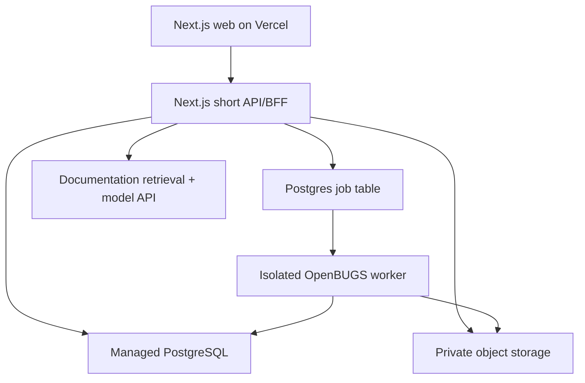

# ReproLab — Harnessed Build Plan

> ## Status update 2026-11-13 (takes precedence over the rest of this file)
>
> This plan was written before the engine feasibility work and the licence review. Where it conflicts with the points below, the points below win.
>
> - **Engine feasibility: GO, local only.** OpenBUGS 3.2.3 rev 1012 ran the Seeds example in a pinned container image on Docker Desktop. Evidence is in `docs/evidence/`.
> - **Pre-declared numerical comparison: FAILED** on all five nodes (two chains pooled, 1,000 burn-in). A later pass with 20,000 burn-in was chosen after that failure and is **post hoc**, not an independent confirmation. No convergence or scientific-validity claim is made.
> - **Publishing or distributing the engine image: NO-GO.** The licence review is incomplete and release gates G1 to G4 are unmet (`docs/release-decision.md`).
> - **Public web runner and public uploads: NO-GO.** Isolation was tested on Docker Desktop only, not on a production host. Any section below that describes a public "Run" button, a guest demo job, judge-launched jobs, or a public worker is a design option that is **not authorised**.
> - **Worker hosting options** (Vercel Daemons, Oracle Cloud Always Free, other hosts) are untested planning notes. None has been chosen, tested or approved.
> - **Licence of the OpenBUGS engine:** the package `COPYING` says GPL v3 and the SourceForge page lists GPL v2. This is unresolved. No repository licence has been chosen yet.
> - **What the public web site is for now:** a static Next.js site (`apps/web`) that shows one recorded sample and its limits. Vercel hosts the web app only.
> - **Definition-of-done items** that require live public engine runs, a published engine image, or an AI assistant are **not met** and remain blocked.


**Plan date:** 13 November 2026  
**Purpose:** A concrete implementation and Kiro IDE workflow for a deployable web product and an eligible Kiroween 2026 submission.  
**Status:** Plan and starter `.kiro` files, not a claim that Kiro has already built or tested the application.  
**First engine:** OpenBUGS, pending an actual modern Linux execution and licensing gate.
**Source model:** The entire submitted ReproLab application is open source. Hosted operations, user data and credentials remain private.

## 0. Decisions that control the build

1. **Web first:** Build the website in **Next.js/React/TypeScript** and deploy it on Vercel. React Native is a separate **Expo mobile client** in a later phase, sharing API contracts and design tokens, not the primary web renderer. Trying to build the browser experience simultaneously in React Native and Next.js increases complexity for a research workflow that needs file editing and large result views. Expo does support a web target, but that is a different routing/deployment path. [Next.js](https://nextjs.org/docs/app); [Expo Router](https://docs.expo.dev/router/introduction/).
2. **Real scientific engine:** ReproLab must execute OpenBUGS or another demonstrated legacy engine; static mock outputs do not count. The [OpenBUGS manual](https://chjackson.github.io/openbugsdoc/Manuals/Scripts.html) documents Linux batch mode. First reproduce a known example on the target worker image.
3. **Vercel deployment:** `apps/web` is deployed to Vercel. A short API request creates a job; the worker runs the engine asynchronously. Vercel Functions have bounded duration and resource limits. [Vercel Daemons](https://vercel.com/i/where-to-host-background-workers) now support persistent container workers in public beta, so **Vercel-only is a possible deployment**, conditional on a full OpenBUGS build, representative run, broker connectivity, isolation, limits, cost, and restart test. If that gate fails, host the isolated worker on a container host/VPS while keeping the web app on Vercel. Do not call the Vercel-only path proven before testing it. [Function limits](https://vercel.com/docs/functions/limitations).
4. **Open-source product:** ReproLab will be developed in a **public GitHub repository** with all source and instructions needed for the demonstrated application, a root `.kiro` directory, and a genuine open-source `LICENSE`. These are also [Kiroween 2026 requirements](https://kiroween.devpost.com/rules). Select the license after checking all included code and OpenBUGS GPLv2 compatibility; then place the actual license text at the root. Publish the web app, worker, adapter and setup instructions. Keep only secrets, credentials and users' private data out of Git. Monetize managed hosting, team services and support rather than withholding necessary source.
5. **Existing code:** OpenBUGS is [GPLv2](https://sourceforge.net/projects/openbugs/). Record its origin and permissions, comply with its license, disclose reused code/assets, and keep the hackathon-created improvements demonstrable. A pre-existing planning document is not evidence that implementation predated the event; use real commit history and disclose any actual pre-existing code. This plan is engineering guidance, not legal advice.

## 1. Target experience and scope

ReproLab lets a researcher choose a tutorial or submit a supported BUGS model and text data, configure a bounded analysis, run the pinned legacy engine, see the genuine log and sample outputs, ask a documentation-grounded question about a failure, and download a reproduction bundle. Version one supports **one engine and one verified tutorial**. It never claims a successful run proves the science is correct.

**Included test project: OpenBUGS Seeds.** The upstream [tutorial](https://chjackson.github.io/openbugsdoc/Manuals/Tutorial.html) uses the [Seeds model](https://chjackson.github.io/openbugsdoc/Examples/Seeds.html), which studies how seed type and root extract relate to germination across 21 plates. Its fixture has a BUGS model, data, separate initial values for two chains, monitored parameters (`alpha0`, `alpha1`, `alpha2`, `alpha12`, `sigma`), and published example summaries. It will be the real end-to-end engine fixture and public demo. First verify rights to redistribute its files or link users to upstream material and provide independently created permitted fixture files. Do not imply that the fixture has already passed on our chosen host.

### Personas and journeys

| Persona | Goal | Required journey |
|---|---|---|
| New researcher | Run a tutorial without installing an old program | Landing → example → settings → run → results → export |
| Returning researcher | Rerun their own model | Sign in → project → model/data → validate → run → compare runs |
| Reviewer/judge | Verify the claim in minutes | Demo URL → start a real job → see OpenBUGS output, manifest, AI citation |
| Account owner | Control their data | Settings → export/delete account and project data |

### Feature matrix and release priorities

| Phase | Feature | Implementation and acceptance evidence |
|---|---|---|
| P0 | Public runnable tutorial | Real Seeds example with pinned inputs; user clicks Run and receives engine-produced output and log |
| P0 | Structured input | Model text, data text, settings and monitored variables; exact validation rules in §5 |
| P0 | Job lifecycle | Queue, worker, timeouts, status polling, explicit failure reason, bounded concurrency |
| P0 | Results | Raw log, sample file(s), summary computed from actual exported data, engine version and checksums |
| P0 | Reproduction bundle | Inputs, generated script, environment manifest, log, outputs, readme; rerun instructions work |
| P0 | AI error helper | Retrieval over licensed/allowed manuals + actual run log; clickable citations; abstain when unsupported |
| P0 | Production shell | Responsive pages, accessibility, legal drafts, contact, custom errors, monitoring, backup/retention notes |
| P1 | Accounts/private projects | Auth, ownership checks, rate limits, account data controls, retention and deletion |
| P1 | Visual diagnostics | Plot samples and summaries using tested calculation code; label sample quality limitations |
| P1 | Compare runs | Compare settings/provenance and only comparable numeric outputs; no blanket equivalence claim |
| P2 | Expo mobile client | Review runs and notifications; editing big BUGS models remains web-first |
| P2 | Organizations/billing | Team access, quotas, invoices, admin, paid plan only after pilot demand and legal review |

## 2. Architecture and deployment choices



**Recommended thin architecture for the deadline:** Next.js Route Handlers for auth, validation, reads, job creation, and AI requests; Python worker for OpenBUGS adapter and result parsing; managed Postgres with a leased jobs table; private object storage. A separate FastAPI HTTP service is unnecessary until another client needs an independent API, but the worker package can expose shared Python domain functions and documented JSON contracts. A later Expo client can call the same authenticated web API or a purpose-built API service. Avoid two competing backend frameworks in the first release.

**Deployment gate D1, Vercel-only:** Build a daemon image containing a pinned OpenBUGS binary, run the Seeds job, enforce time/memory/disk limits, prove job isolation, connect to queue/storage, restart during a job, and process the retry exactly once or mark it safely interrupted. Confirm the currently available Daemons features and billing for the account. Public beta is a material operational risk. An application-level process limit inside a worker container is not equivalent to per-job kernel isolation; if uploads from the public are allowed, verify a stronger per-job sandbox or use a host that supports it.

**Deployment gate D2, fallback:** Vercel remains the user-facing production website. Run an isolated Python worker on a container service or VPS with per-job containers/microVMs and no inbound public API; connect to the same database and storage. Monitor and restart it. This is still a Vercel-deployed website, though the engine compute is external. The site cannot honestly promise successful new runs while all workers are offline: expose a status page and return a clear `worker_unavailable` or queue delay.

### Where to run the engine if Vercel Daemons cannot run it

The **first recommendation for a low-traffic hackathon demo** is to test an **Oracle Cloud Always Free AMD x86 VM** for the continuously running worker. Oracle lists up to two AMD micro instances with 1 GB RAM and 1/8 OCPU each. This matches the historically documented Intel-family Linux build better than its larger Arm free shape, but 1 GB RAM and limited CPU may still be too small or slow; measure one full Seeds run and one failure before deciding. Instances depend on capacity in your home region and idle free instances can be reclaimed. Put the database and files in managed persistent services; do not assume those services are free. [Oracle Always Free resources](https://docs.oracle.com/en-us/iaas/Content/FreeTier/freetier_topic-Always_Free_Resources.htm).

An **on-demand alternative** is **Google Cloud Run Jobs**: build a Linux x86 container and execute a job per analysis rather than maintaining a constantly polling worker. The job has a published monthly compute free allowance, but requires a billing account and charges can occur above that allowance or for related storage/network services. This changes the dispatcher design from polling a Postgres job table to authenticated job creation; implement it only if chosen during the deployment gate. [Cloud Run Jobs](https://docs.cloud.google.com/run/docs/create-jobs); [pricing](https://cloud.google.com/run/pricing); [free-tier conditions](https://docs.cloud.google.com/free/docs/free-cloud-features).

For a **reliable paid production path**, use a small x86 VPS or managed container worker with measured RAM/CPU and per-job isolation. Render's free offering covers web services/datastores, not a free always-on background worker; do not plan to keep the engine alive there for free. [Render free services](https://render.com/docs/free); [service types](https://render.com/docs/your-first-deploy). Vercel Daemons may itself fit within included usage for a small demo, but check account eligibility, current limits and actual usage before claiming zero cost. [Vercel pricing](https://vercel.com/pricing).

**Free is conditional:** the code can be deployed on free allowances for a small demo, but this is not a promise of cost-free, uninterrupted production. Set hard quotas and budget alerts; verify storage, database, AI API and outbound traffic separately. Never run the engine on your own laptop as the sole live judge backend.

**Uploads:** For the initial demo, keep files small and text-only. Vercel Functions limit request and response payloads to 4.5 MB; for larger private files, use authenticated direct-to-object-storage uploads and short-lived signed downloads. Do not pass data files through the AI provider by default. [Vercel payload guidance](https://vercel.com/docs/errors/function_payload_too_large).

## 3. Stack, packages, and contracts

| Area | Planned implementation | Why |
|---|---|---|
| UI | Next.js App Router, React, TypeScript, Tailwind, Radix primitives or similarly accessible components | Good form, log and result ergonomics; server-rendered public pages |
| Forms/validation | React Hook Form + Zod shared schema | Same documented constraints in UI and server; server remains authoritative |
| Authentication | A maintained auth library with email/OAuth; choose one during spec review | Do not write session cryptography yourself; demo guest flow first |
| Database | PostgreSQL + Prisma or Drizzle; choose one before schema migration | Projects, runs, audit metadata, doc index, ownership |
| Job dispatch | Next.js API writes a `queued` row in Postgres; Python worker claims jobs with `FOR UPDATE SKIP LOCKED` | One fewer service for an MVP, transactional claim, bounded load. Use a dedicated queue later only if throughput demands it. No browser waits for processing. |
| Storage | Private S3-compatible object storage; local filesystem only in development | Inputs, outputs, manifests; bounded signed access |
| Engine | OpenBUGS Linux binary/script interface, pinned image and hashes | Execute historical model rather than translate it |
| AI | Curated docs → chunk by heading → Postgres full-text ranking → bounded model answer with checked citations | Source grounding; optional embeddings only if evaluation shows need |
| Observability | Structured JSON logs, error tracking, uptime/status checks | Trace every run and deployment |
| Tests | Vitest for pure TS, pytest for runner, Playwright for browser journey | Verify actual boundaries, not snapshots of mock data |
| Mobile later | Expo/React Native in `apps/mobile`, shared API schemas and design tokens in `packages/` | Meets future mobile goal without delaying browser delivery |

**Important queue implementation decision:** The initial Postgres queue is the single chosen MVP path. A worker claims a queued job in a short transaction with `SKIP LOCKED`, sets a lease and heartbeat, runs it outside the transaction, then commits a terminal state. A lease sweeper recovers abandoned jobs. Use an idempotent artifact key based on run ID and attempt. Do not hold a database lock during an OpenBUGS run. Introduce Redis/RQ only if measured load requires it; revise the spec first.

Data tables: `users`, `projects`, `model_versions`, `runs`, `run_attempts`, `artifacts`, `doc_sources`, `doc_chunks`, `assistant_questions`, `audit_events`. Run has `queued/running/succeeded/failed/timed_out/cancelled`, a pinned engine image digest, input and output hashes, settings JSON, a lease, and timestamps. Artifacts store private object keys, size, SHA-256, media type, retention date. Keep short public demo runs separate from authenticated projects.

API contract (under `/api/v1`): `GET /examples`, `POST /runs`, `GET /runs/:id`, `GET /runs/:id/log?cursor=`, `GET /runs/:id/artifacts/:id/download`, `POST /runs/:id/questions`, `POST /runs/:id/cancel`, `GET/POST /projects`, `GET /health`; account endpoints later. All write endpoints validate origin/session, authorize owner, rate-limit, and use typed problem responses `{code,message,field?,requestId}`. Run creation uses an idempotency key.

## 4. Design system and complete page inventory

**Design direction:** Calm research workspace, light by default with optional dark mode. Avoid horror-themed UI that impairs credibility. A small “revive a lost workflow” motif can support the Kiroween story. Use a restrained palette: ink `#182232`, paper `#FAFBFC`, surface `#FFFFFF`, primary `#236B70`, accent `#B65C3A`, success `#217A55`, warning `#9C6500`, error `#B43B3B`. These are proposed tokens and must be checked for WCAG contrast. Use a legible sans font for prose and monospace only for model code/logs. 8px spacing scale, 4/8/12px radii, clear focus ring, responsive 12/8/4-column layouts. Charts need labels and tables, never color alone.

Reusable components: `AppShell`, `PublicHeader`, `Footer`, `Button`, `FormField`, `FileDropzone`, `ModelEditor` (simple text area first; editor later), `JobStatus`, `LogViewer`, `RunSettings`, `ArtifactList`, `CitationCard`, `ResultTable`, `EmptyState`, `ErrorBanner`, `ConfirmDialog`, `Toast`, `CookiePreferences` only if optional tracking is used. Use semantic HTML, keyboard navigation, labels, error summaries, loading announcements, and reduced-motion support.

| Route/page | Content and purpose | Release |
|---|---|---|
| `/` | Problem, how it works, link to the recorded sample (a live demo CTA is NO-GO), trust limits, examples | P0 |
| `/how-it-works` | What OpenBUGS runs, input/output and reproducibility, honest limitations | P0 |
| `/examples` and `/examples/[slug]` | Licensed/attributed examples and setup | P0 |
| `/demo` | Guest run with known example, quota and privacy notice | P0 |
| `/runs/[id]` | Status, settings, log, results, citations, provenance, downloads | P0 |
| `/docs` and `/docs/[slug]` | Product instructions, supported formats and FAQs; link to upstream manuals | P0 |
| `/about` | Mission, team, source acknowledgments | P0 |
| `/contact` | Contact method and support expectations | P0 |
| `/legal/terms` | Actual Terms of Service; acceptable use, job limits, ownership, warranty/limitations | P0 draft reviewed before launch |
| `/legal/privacy` | Data collected, purposes, processors, retention, deletion, AI disclosure, contact | P0 draft reviewed before launch |
| `/legal/licenses` | Product license link, OpenBUGS GPLv2 notice, third-party notices and attribution | P0 |
| `/legal/cookies` | Cookies used and consent choices if nonessential tracking is enabled | Conditional |
| `/accessibility` | Accessibility statement, known issues and contact | P0 |
| `/status` | Worker availability and incidents; manual simple status first | P0 |
| `/auth/sign-in`, `/auth/sign-up`, `/auth/reset-password` | Identity flows; only publish those actually enabled | P1 |
| `/app` and `/app/projects` | Dashboard, projects, latest runs, empty state | P1 |
| `/app/projects/new`, `/app/projects/[id]`, `/app/projects/[id]/edit` | Create/edit model, data and settings | P1 |
| `/app/settings`, `/app/settings/data` | Profile, data export, deletion/retention | P1 |
| `/pricing` and `/billing` | Real prices and checkout when a paid plan exists; no fake pricing | P2 |
| `not-found`, `error`, `loading`, `maintenance` | Human-readable recovery and support | P0 |

Footer links to About, How it works, Docs, Status, Contact, Terms, Privacy, Licenses, Accessibility. SEO metadata, sitemap, robots directives, social cards and structured metadata for public pages; `noindex` private runs/projects. Add mobile navigation and test 320px through desktop widths. Native mobile screens, when built, should cover sign-in, projects, run list/details, alerts, settings and legal links.

## 5. Inputs, outputs, and validation matrix

All caps below are **initial product policy proposals** to confirm against a real OpenBUGS job and hosting costs. Implement each rule in the server; client validation is a convenience. Show exact actionable errors. Do not claim a BUGS model is valid until the engine checks it.

| Input | Proposed check | Failure behavior |
|---|---|---|
| Model text | Required, plain ASCII per Linux manual, `.txt` or pasted text; 1 byte–256 KiB; no NUL; normalize line endings, preserve original hash | Field error with encoding/size guidance |
| Data text | Required for jobs needing data; ASCII `.txt`, 1 byte–2 MiB, no NUL; reject path-like filenames | Show file and format issue |
| Initial values | Optional one text file per chain; accepted only if count matches selected chains | Point to missing or extra chain |
| Chains | Integer 1–4 initially; example uses known-good default | Reject outside range; cap total work |
| Warm-up and sample iterations | Integers, bounded e.g. 100–50,000 each, with total `chains × (warmup + sample)` under a measured cap | Show limit before submission |
| Monitored parameters | 1–25 unique names, conservative character allowlist; confirm actual syntax in engine | Reject duplicates/invalid names |
| Seed/random-number setting | Use only values documented by OpenBUGS; record exact setting in manifest | Reject unsupported setting |
| File count / request | Max count/size per tier; rate-limit user and IP; total file budget | `413`/`429` with recovery text |
| Assistant question | Bounded length, one run user may access; scrub secrets, refuse arbitrary URLs | Show scope/permission errors |

Server verifies magic/encoding and may stage files under fixed generated names. Never use original filenames in shell interpolation. Reject archives and binaries in MVP. Reject attempts to choose an executable or pass extra command-line flags. Read all text with a bounded decoder. The engine handles BUGS syntax and model semantics; capture check/compile errors verbatim with safe log redaction.

| Output | Contract and validation |
|---|---|
| Job status | Explicit state, timestamps, attempt, progress stage; no `succeeded` before required artifact checks |
| Log | Bounded pagination and full private artifact; preserve original log, redact host paths/secrets in UI |
| Samples | Parse only validated export format; match monitored nodes and chain count where available |
| Summary | Means/intervals from actual samples with calculation version; no invented “scientific significance” |
| Manifest | Engine release/digest, adapter version, settings, input/output SHA-256, generated script, runtime, failures |
| Bundle | Deterministic paths for inputs/script/log/samples/manifest/readme; verify checksums after creation |
| AI response | Answer + source IDs/URLs + applicable log lines + uncertainty; fail closed on missing citation |

**Algorithm choices:** Postgres lease-based queue for the MVP (small service footprint); SHA-256 for artifact integrity; stable run IDs and idempotency keys; line/heading chunking plus PostgreSQL full-text search for RAG; deterministic known-error mapping before model explanation; statistical summaries calculated directly from samples with tested numerical library, not an LLM; paginated log retrieval; finite state transitions rather than free-form status strings. Add vector search only if a held-out question set proves it improves retrieval. Avoid premature microservices.

**Memory and performance:** stream artifact upload/download; limit simultaneous jobs per worker; process logs line-by-line with bounded tail in UI; parse samples by chain or in chunks; cap rows charted with a documented downsampling method while summary calculations use full validated samples; bound prompt context and per-user AI requests; close file handles; delete temporary job directories in `finally`; enforce disk quotas and TTL cleanup; choose CPU/memory limits from measured Seeds and larger representative runs. Cache public docs, never cache private run content across users. Instrument p50/p95 job runtime, queue wait, memory high-water mark, artifact size and error rate before raising limits.

## 6. Security, privacy, and resilience

Threat model: user-supplied model/data can be malformed or malicious; native old code may crash; guest traffic can exhaust CPU/AI spend; private runs can be accessed via guessed IDs; retrieved docs/logs may contain prompt injection. Put engine processes in an isolated, non-root, outbound-network-disabled job sandbox with allowlisted mounts, read-only base image, no host Docker socket, CPU/memory/pid/disk/time quotas. Verify available isolation on the chosen worker host; public custom uploads remain gated until that test passes. Use short-lived object-store access, authorization on every read, CSRF/origin validation, secure cookies, rate limits, secret rotation, dependency scanning and redacted logs.

Durability: Postgres backed up; artifacts in private persistent storage; lease/heartbeat for jobs; after crash, reclaim only expired leases and ensure result write is idempotent; retry transient infrastructure errors at most a bounded count, not invalid models. One worker processes one heavy run initially. Deploy with rollback path and migration compatibility. Provide data export/delete and transparent retention; retain guest example outputs briefly, private data according to published policy. Hosted AI must be disclosed accurately; no claims of HIPAA/GDPR compliance without actual review.

## 7. Kiro development harness and truthful evidence

The companion `ReproLab_Kiro_Starter.zip` contains a **root `.kiro/` starter** with specs, steering and a safe example hook. Copy `.kiro` to the root of the new repository, commit it, and **use Kiro IDE to review and revise the specs while building**. A template alone does not establish meaningful use of Kiro. Kiro's [Specs documentation](https://kiro.dev/docs/specs/) defines `requirements.md`, `design.md`, and `tasks.md`; [Steering](https://kiro.dev/docs/steering/) and [Hooks](https://kiro.dev/docs/hooks/) provide persistent guidance and event-based checks.

### Recommended session loop for every feature

1. In Kiro IDE open the repo root; create the foundation Steering docs from its panel; compare and merge with the starter files, keeping a single source of truth.
2. Create a Kiro feature Spec (Requirements-First) for the next vertical slice. Review requirements and acceptance criteria before design. Have Kiro analyze gaps and conflicting assumptions; save decisions in the spec.
3. Review `design.md` for trust boundary, data contract, and deployment. Split `tasks.md` into one testable change per item, with dependencies and demo result.
4. Ask Kiro to implement **one task**, inspect the diff, run its suggested focused check, perform the real flow, and commit. Record failures and changed decisions. Do not check off a task because Kiro merely generated code.
5. Have Kiro use the lint/type-check hook after changed TS files and a targeted runner test before a worker task is complete. Use a prompt hook for missing tests only when its event and cost are understood. No broad automatic fixes on every save.
6. At the end of each vertical slice, add a short `docs/build-log.md` entry: date, Kiro surface/feature used, prompt/decision, resulting commit, verification evidence. Remove secrets and personal data; capture actual workflow for Devpost.

**Suggested `.kiro` tree** (included as starter files):

```text
.kiro/
  steering/
    product.md
    engineering.md
    scientific-integrity.md
    security-and-privacy.md
    open-source.md
  specs/
    00-engine-feasibility/
      requirements.md
      design.md
      tasks.md
    01-end-to-end-web-run/
      requirements.md
      design.md
      tasks.md
    02-grounded-assistant/
      requirements.md
      design.md
      tasks.md
  hooks/
    validate-on-save.json
```

These files contain plans, not fictional checkmarks. The hook is disabled until a corresponding script exists and the exact installed Kiro version accepts the configuration. Enable and test it in the IDE; document its real effect. The `.kiro` directory must **not** be ignored in `.gitignore`, and it must be included in public GitHub with the project. No Kiro account IDs, API keys, private chats or machine-specific paths in this folder.

## 8. Repository structure and release operations

```text
reprolab/
  .kiro/                         # committed specs, steering, tested hooks
  apps/
    web/                         # Next.js App Router, public/app pages, route handlers
    mobile/                      # Expo/React Native, P2 only
  packages/
    contracts/                   # generated/typed API schemas
    design-tokens/               # colors, spacing, typography; no forced shared UI
  services/
    runner/                      # Python OpenBUGS adapter, worker, parsers
  examples/openbugs/seeds/       # attributed tutorial fixture, rights checked
  infra/                         # worker image, local Compose, deploy configuration
  docs/
    architecture.md
    api.md
    deployment.md
    security.md
    build-log.md
    third-party-notices.md
  tests/e2e/                     # actual browser-to-worker tests
  .github/workflows/             # lint/type, Python tests, build, license checks
  .env.example                   # variable names, no secrets
  LICENSE                        # actual open-source license for submitted code
  README.md                      # setup, demo, supported scope, attribution
  CONTRIBUTING.md
```

Choose a product license compatible with the architecture **after** reviewing the GPLv2 component boundary. Include OpenBUGS's required license/notice and precise attribution, and do not mislabel it as code you wrote. The hackathon repo must include all source and instructions needed for the demonstrated application to function. Paid hosting, team administration and support can be offered around the open-source application. Terms of Service and Privacy Policy are website documents, **not substitutes for a repository open-source license**.

Environment variable checklist: database URL, object-store endpoint/bucket/credentials, auth secret/OAuth keys, AI provider key, allowed site origin, worker lease/limits, logging DSN. Separate dev/staging/prod; never commit values. CI on PR runs lint, typecheck, runner fixture, schema migration check and web build; protected release tag deploys worker and Vercel web with a smoke test and rollback.

## 9. Work sequence to 4 December 2026

The published submission deadline is **4 December 2026, 2:00 p.m. Pacific**; use Devpost's live countdown for the local-time cutoff. [Official rules](https://kiroween.devpost.com/rules). Reserve the final days for submission and demo rather than the first working run.

| Window | Deliverable | Stop/go proof |
|---|---|---|
| 13–16 Nov | Repo, `.kiro` foundation, engine source/license inventory, local pinned batch Seeds run | Actual binary runs; numerical output captured; license route understood |
| 17–21 Nov | Web vertical slice, DB, worker claim/lease, artifact storage, Vercel preview | Fresh user can start a real run and download log |
| 22–26 Nov | Own-model form, checks, results/manifest/bundle, failure handling, isolation gate | Good and bad inputs behave as specified; public uploads remain gated until safe |
| 27–30 Nov | Curated manual retrieval and AI citations, UX polish, legal drafts, complete public pages | Human-reviewed questions answered with valid citations; responsive and accessible |
| 1–2 Dec | Production Vercel deployment, worker availability, judge guest route, tests, README, license and `.kiro` review | External tester completes full flow without credentials or with supplied judge login |
| 3 Dec | Record/verify <3-minute public YouTube video, English write-up and Kiro usage record; submit early | All submission URLs work and match the running app |

**Cut scope early if needed:** First protect the real engine run, manifest, meaningful Kiro use, public functional URL, source license, `.kiro`, and demo. Mobile, billing, organizations, model conversion, arbitrary uploads, and embeddings are optional after that proof. Do not submit mock outputs as the core feature.

### Definition of done for hackathon (original wording; the first, second and third items are NOT met and are blocked by the NO-GO decisions in the status update at the top)

- A judge can launch a fresh Seeds job on the live site; log and outputs are from the engine.
- The site shows engine version, settings and downloadable reproduction manifest/bundle.
- An AI answer cites an existing OpenBUGS manual section and relevant real log line, or says it lacks evidence.
- Web and worker deployment are monitored; failed worker yields a clear status, not a silent spinner.
- Public GitHub contains actual working source, instructions, visible open-source license, third-party attribution and root `.kiro`.
- Kiro IDE work is genuine and explained with actual spec revisions, tasks, hook use where tested, and commits.
- Functional URL, public YouTube demonstration under three minutes, English description and testing access meet the [2026 rules](https://kiroween.devpost.com/rules). The rules are the authority; this checklist is not a prize guarantee.

## Sources and evidence boundary

Official sources used: [Kiroween 2026 rules](https://kiroween.devpost.com/rules), [Kiro Specs](https://kiro.dev/docs/specs/), [Kiro Steering](https://kiro.dev/docs/steering/), [Kiro Hooks](https://kiro.dev/docs/hooks/), [OpenBUGS scripts](https://chjackson.github.io/openbugsdoc/Manuals/Scripts.html), [OpenBUGS Seeds tutorial](https://chjackson.github.io/openbugsdoc/Manuals/Tutorial.html), [OpenBUGS project/license](https://sourceforge.net/projects/openbugs/), [Next.js App Router](https://nextjs.org/docs/app), [Expo Router](https://docs.expo.dev/router/introduction/), [Vercel Function limits](https://vercel.com/docs/functions/limitations), [Vercel worker options](https://vercel.com/i/where-to-host-background-workers), [Vercel pricing](https://vercel.com/pricing), [Oracle Always Free](https://docs.oracle.com/en-us/iaas/Content/FreeTier/freetier_topic-Always_Free_Resources.htm), [Google Cloud Run Jobs](https://docs.cloud.google.com/run/docs/create-jobs) and [pricing](https://cloud.google.com/run/pricing), [Vercel upload limit](https://vercel.com/docs/errors/function_payload_too_large). Architecture, limits, colors, milestones and business choices are proposed decisions and require testing in the real project.
